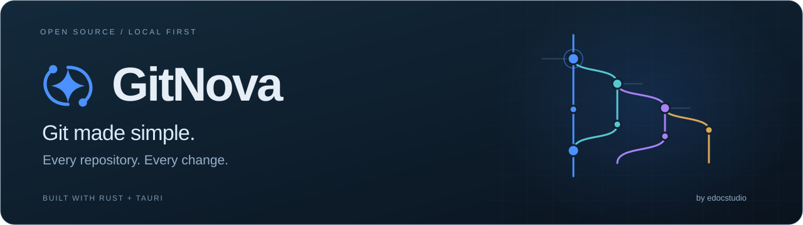
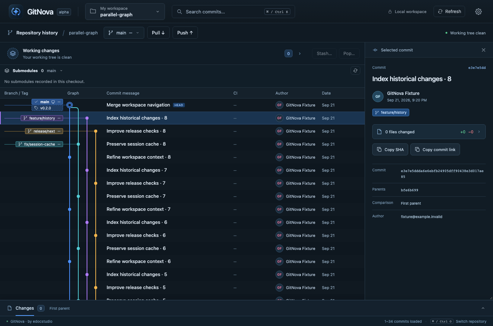
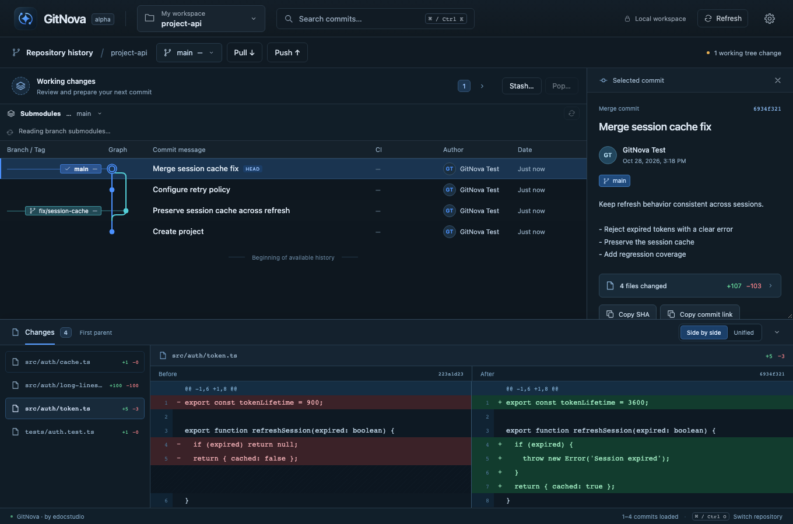

<p align="center">
  
</p>

<p align="center">
  A local-first desktop Git client for developers who work across repositories.<br />
  Built with Rust, Tauri, React and TypeScript.
</p>

<p align="center">
  <a href="LICENSE"></a>
  <a href="#project-status"></a>
  <a href="Cargo.toml"></a>
  <a href="docs/implementation.md"></a>
</p>

<p align="center">
  <a href="#getting-started">Getting started</a> ·
  <a href="#features">Features</a> ·
  <a href="docs/implementation.md">Documentation</a> ·
  <a href="#roadmap">Roadmap</a> ·
  <a href="CONTRIBUTING.md">Contributing</a>
</p>

**GitNova brings your repositories, branches and changes into one visual workspace.** Follow history in the Git graph, inspect a diff, then review the next Git operation in the same context. Local Git workflows work without a GitNova account or a cloud service. Hosting and CI connections are optional.

<p align="center">
  
  <br />
  <sub>GitNova running against a real temporary Git repository. The screenshot uses a test fixture, not a company repository.</sub>
</p>

## Why GitNova?

- **See the story in the graph.** Trace branches and merges, inspect commits, and reach contextual actions with a right click or a double click.
- **Work across repositories.** Keep related repositories in a workspace, pin frequent projects, search the repository picker and retain graph context while switching.
- **Review the change before applying it.** See the source, destination and selected scope. Git writes are revalidated; consequential operations retain receipts and recovery evidence.
- **Keep your workflow local.** GitNova uses your installed Git and configured authentication. Accounts are needed only for optional hosting and CI integrations.
- **Built for a small resource footprint.** Rust services use bounded Git workers, read budgets, caches and virtualized history/diffs. Performance and long-session RAM validation remain active work.

## Features

The following workflows are implemented in the current alpha. Availability does not imply production or cross-platform certification; see [project status](#project-status) and the [detailed limits](docs/implementation.md#current-limits-and-next-work).

| Area | What you can do today |
| --- | --- |
| **Workspaces** | Add or clone repositories, switch within one window, pin projects, and search a five-repository-per-page picker. |
| **History & diffs** | Browse a virtualized graph with branch/tag labels; inspect side-by-side or unified patches and historical files. |
| **Everyday changes** | Stage/unstage individual files or review Stage all, create a first commit with bounded per-file previews, amend the latest commit, or discard selected changes with recovery capture. |
| **Branches & remotes** | Set up a reviewed repository destination from Push; preview checkout, fetch, pull, push, rename/delete branches, and inspect local/upstream ahead/behind counts. |
| **Merge & selected changes** | Review a merge commit or fast-forward, resolve supported text conflicts in a three-way editor with per-block choices, cherry-pick/revert a commit, and review finish/abort. Optionally delete the local source branch after a successful merge. |
| **Stashes** | Save work, inspect saved entries in the graph, and apply/pop onto the current branch. Recovery and conflict limits are documented. |
| **Submodules & worktrees** | Inspect branch-specific submodules, open their graphs, initialize/restore recorded versions and stage pointer changes; sync selected initialized submodule URLs; list, create, open, lock/unlock, repair and safely remove supported linked worktrees. |
| **Search** | Find commits by message, author, email or SHA across the current repository, selected repositories or workspace. |
| **Tags & collaboration** | Create/publish version tags, copy remote commit links, and create/open GitHub pull requests or GitLab merge requests. |
| **CI visibility** | Display GitLab commit status and GitHub checks/status in the graph. Global host/company connections and optional Jenkins integration live in Settings. |
| **Languages** | Switch between English and Thai from Settings → General without losing drafts or selection. |

CI evidence is tied to the exact commit and connected host. Jenkins results can appear when reported to that Git host; connecting a Jenkins account does not automatically discover arbitrary jobs.

<details>
<summary><strong>See commit inspection and the diff dock</strong></summary>

<p>
  
</p>

Captured from a temporary Git fixture using the real Rust core through the browser test transport. Native WebView and provider-account acceptance are tracked separately.

</details>

## Getting started

### Requirements

- **Rust stable 1.98+**, Cargo, and an installed **Git** executable.
- **Node.js 20.19+ or 22.12+** and npm. The repository includes an [`.nvmrc`](.nvmrc).
- The [Tauri system prerequisites](https://v2.tauri.app/start/prerequisites/) for your OS.

### Run from source

Clone this repository, then run from its root:

```sh
# Optional, if you use nvm:
nvm use

cd apps/desktop
npm ci
npm run tauri dev
```

Add an existing repository by its absolute path, or clone one from the workspace picker. Use **Cmd/Ctrl+O** to switch repositories and **Cmd/Ctrl+K** to search commits. **Cmd/Ctrl+,** opens Settings.

`npm run dev` starts a browser preview; use `npm run tauri dev` for local Git access.

### Publish an existing local project

1. Open the local Git repository in GitNova. Select **Working changes → Stage all changes…**, review the listed files, then confirm staging. Ignored files stay excluded; submodules require their separate pointer workflow.
2. Enter a summary, select **Review commit**, inspect staged files, then **Commit staged changes**.
3. Select **Push → Add remote…** when no destination is configured. Use an existing clone URL or select a connected GitHub/GitLab account to create a new empty repository with an explicit owner, name, description and access level. Accounts are managed in **Settings → Connections**.
4. Review repository creation (if needed), then review and add the local remote. Creation and local configuration are separate effects; no code is sent by either step.
5. Review the Push destination and upstream choice, then confirm publication.

On macOS, HTTPS Git operations use the matching host account saved in GitNova Settings, with a process-local credential helper and Keychain access. Without a saved account, configured Git credentials remain available; SSH uses your agent. The token must have repository access and the required read/write permission. GitNova does not grant Git-host access automatically. See [first-project publication](docs/milestone-50.md) and [Push destination setup](docs/milestone-53.md) for bounds and verification.

### Build a standalone macOS app

From `apps/desktop`:

```sh
npm run build:local
```

Open the `.app` path printed by the builder. The default output is `target/debug/bundle/macos/GitNova.app` relative to the repository root. Close GitNova before building; the builder updates this single app and refuses to overwrite a running instance. The bundle embeds the UI and runs without a development server.

This produces a local, ad-hoc-signed **debug build** with CPU-heavy first-party Rust crates optimized at level 2; debug assertions and debug information remain enabled. Public installers, notarization and full release-profile validation are still planned.

## Project status

**GitNova is an alpha, version 0.1.0.** Everyday workflows are implemented, and the broader multi-repository roadmap is still in progress.

| Platform | Current validation |
| --- | --- |
| **macOS · Apple Silicon** | Local development, debug packaging and targeted native smoke checks have been exercised. |
| **Linux / Windows** | Core CI jobs are configured. Full native desktop acceptance and distribution remain unverified. |

The [checks workflow](.github/workflows/ci.yml) defines the repository's CI jobs; it is not a claim that a hosted run has passed. GitNova does not yet ship public release installers.

Git operations can encounter conflicts, configured hooks/filters, interrupted processes or external repository changes. Recovery references, snapshots and receipts have explicit bounds. Review the [workflow and recovery limits](docs/implementation.md#current-limits-and-next-work) before relying on them for important work.

## Roadmap

The graph remains the primary interface as GitNova grows. The architecture follows these phases:

| Phase | Direction |
| --- | --- |
| **1 · Workspace foundation** | Repository/worktree identities, memberships, switching and status. |
| **2 · Everyday Git** | Visual history, working changes, remotes and reviewed Git operations. |
| **3 · Submodules & worktrees** | Complete the remaining lifecycle and recovery workflows. |
| **4 · Search & archaeology** | Extend workspace commit search into file and code investigation. |
| **5 · Smart change preview** | Explain planned changes and their risks before writing. |
| **6 · Release intelligence** | Investigate coordinated changes across repositories. |

Reviewed linear Rebase and tracked-text Stage/Unstage hunk are available. See [scope and recovery](docs/milestone-56.md).

**Next priorities:** broader rebase/hunk support, remaining submodule/worktree operations, long-session performance/RAM measurement, and more recovery testing from real usage. SQLite FTS5 indexing is also planned; current catalog/index persistence uses JSON.

See the [architecture and milestone plan](docs/architecture/overview.md), [delivery priorities](docs/delivery-priorities.md) and [measured operation performance](docs/milestone-47.md). The published performance samples describe a local debug fixture, not a cross-product comparison or a latency guarantee.

## Contributing

Bug reports, reproducible fixtures, documentation, translation and focused pull requests are welcome. Read [CONTRIBUTING.md](CONTRIBUTING.md) for setup, checks and the graph-first interaction rules.

All Git-writing test setup belongs in disposable repositories. Run build/test suites one at a time; focused checks are preferred during development.

## Documentation

| Start here | Details |
| --- | --- |
| [Usage & implementation reference](docs/implementation.md) | Workflows, commands, supported behavior and current limits. |
| [Architecture](docs/architecture/overview.md) | Domain boundaries, stable identities and the roadmap. |
| [Interaction principles](docs/ux/workflows.md) | Current context, selected scope, next action and resulting state. |
| [Architecture decisions](docs/adr/) | Reviewed writes, recovery, search and bounded caches. |
| [Dependencies](docs/architecture/dependencies.md) | Technology choices, verification and licensing notes. |
| [Brand assets](docs/brand/README.md) | The original Orbital Nova identity and source assets. |

## License

Copyright 2026 Ittipon Bangudsareh.

GitNova is licensed under [Apache License 2.0](LICENSE). Third-party components retain their own licenses and notices; see [NOTICE](NOTICE).

<p align="center">
  <strong>GitNova · by edocstudio</strong><br />
  <sub>Git made simple. Every repository. Every change.</sub>
</p>

### Learn Git with GitNova

Read the [FAQ & guide](docs/guide/faq.en.md) ([ภาษาไทย](docs/guide/faq.th.md)), or open **Settings → FAQ** inside the app. Covers everyday workflows, submodules, cherry-pick, conflicts and recovery.
