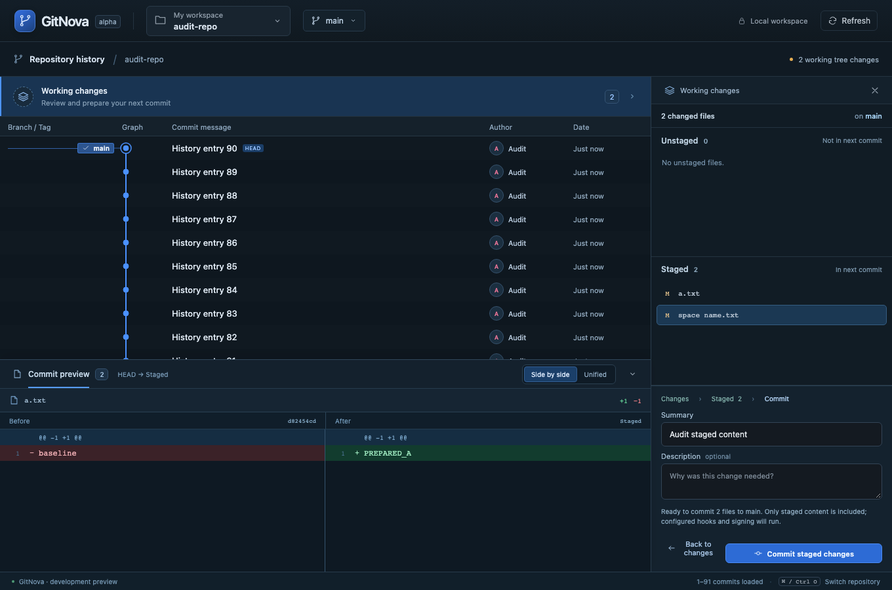

# GitNova implementation and requirement review — 2026-10-25

Verdict: the implemented core workflows follow the agreed graph-first direction, but the complete multi-repository MVP is not accepted. Three reproduced defects affect the promised selection/context/result contract. Fix those before extending the current UX to more Git operations.

This review compares the master prompt, mandatory multi-repository addendum, subsequent user requests, workflow contract, production source and actual temporary Git fixtures. It adds this report and evidence only; application behavior was not changed during the review.

## Findings, in priority order

### F1 — P1: Selected staged file can display another file's diff

Sources: `apps/desktop/src/diff.ts:7`, `diff.ts:11`, `CommitDiffDock.tsx:71–73`, `WorkingDetails.tsx:45`.

The patch parser does not decode Git's quoted path headers or distinguish separator tabs. For an ordinary name `space name.txt`, the parsed `+++` path contains a trailing separator tab. A quote or literal tab in a name also fails to decode into the selected path. The dock compares this parsed display string to `NativePath.display`; if it cannot find a match, it silently uses file index zero.

Reproduced through the running frontend and real Rust/Git bridge: stage `a.txt` and `space name.txt`, enter review, select `space name.txt`. The selected row is `space name.txt`, but the dock header and added content are for `a.txt`. Production-parser probes also reproduce failures for tab and quote names. A normal `a.txt` case matches correctly.

Impact: a user can approve a staged commit after seeing a different file than the selected one. The backend still commits the actual staged index; this finding does not demonstrate altered or lost bytes. It invalidates the claim that selecting each included file reliably shows its corresponding evidence.

Fix: parse Git path quoting/escaping and separators correctly, retain path identity independently from presentation, and fail visibly rather than select another file when matching is uncertain. Avoid a blanket trim that could erase real filename whitespace. Add real staged fixtures for spaces, quotes, tabs and supported non-UTF-8 names, including multi-file review.

### F2 — P2: Refresh discards stored graph scroll context

Sources: `apps/desktop/src/App.tsx:52–60`, `App.tsx:65–69`, `History.tsx` viewport restoration.

`load(id, false, true)` preserves the selected OID but replaces the loaded range with the first page and writes `scroll: 0` / `base: 0`. The existing viewport may temporarily remain scrolled because its restoration effect does not run on every session change. A repository switch then remounts history using the overwritten zero scroll value.

Reproduced: open a 91-commit real repository, scroll to 900px, click Refresh, open another repository and switch back. Restored scroll is 0px. The unchanged graph without that refresh is not the failing case.

Impact: inspection loses position after refresh/fetch/ref reconciliation, contrary to preserving graph context per repository. Older loaded selections can also outlive the replaced first-page range.

Fix: preserve or re-anchor the visible commit and loaded range when refreshing; reconcile changed refs and cursor state explicitly. Test refresh, fetch, external ref updates and switching repositories after loading older pages.

### F3 — P2: Leaving the working inspector can hide a write failure

Sources: `apps/desktop/src/WorkingDetails.tsx:16–18`, `WorkingDetails.tsx:49–57`, `App.tsx:94`, `App.tsx:119`; graph selection remains enabled while a write is pending.

Operation receipts and errors live in WorkingDetails component state. The close button and repository picker are disabled during a write, but selecting a historical commit still unmounts that component. When the request later completes, its receipt/error is set on the unmounted inspector. There is no repository-scoped receipt presentation to take over.

Reproduced with a temporary repository's pre-commit hook that waits three seconds and exits with `AUDIT_EXPECTED_COMMIT_FAILURE`: confirm commit, select a historical commit while it is pending, then wait for completion. The real core returns a failed receipt and HEAD stays unchanged; the failure message is absent from the UI. The durable receipt remains on disk.

Impact: the user cannot tell that the attempted action failed, violating the agreed pending → result → recovery sequence. This reproduction demonstrates missing feedback, not unsafe backend commit execution.

Fix: make operation status/results survive inspector navigation, keyed by repository/worktree, and present them through an existing context/status surface. Alternatively guard context changes during short writes. Keep duplicate-operation protection and do not add an activity dashboard merely to compensate. Add slow/failing hook and navigation regressions.

## Requirement reconciliation

| Requirement | Observed implementation | Assessment |
| --- | --- | --- |
| Graph-first, contextual, no permanent dashboard | One graph, existing workspace/branch pickers, inspector and shared dock; surface rationale recorded | Implemented direction |
| Clear workflows, original UI | Dedicated refs, persistent colored lanes, compact rows, stable working composer, staged scope and inline confirmation | Implemented in covered workflows; F1–F3 prevent full UX sign-off |
| Multi-repo workspace model | Persisted workspace/membership IDs, shared common-dir repo IDs and distinct worktree IDs; existing-repo add, pin/recent, status and switching | Foundation implemented; clone into workspace absent |
| Repository context | Up to eight in-memory graph sessions, selected commit and draft per membership | Partial: F2; working file selection/review is component-local; no restart restoration |
| Real graph correctness | Native date-order traversal, Rust sparse lanes/cursor, merge/octopus/criss-cross/skew/page fixtures, viewport rendering | Implemented and covered; deep-page traversal cost and huge histories remain unbenchmarked |
| Everyday stage/unstage/commit | Real preview tokens, isolated index preparation/native locks, staged review, hooks/signing, receipts | Implemented subset; F1/F3 are UI defects, not bypasses of backend token validation |
| Local/remote branches | Local switch, configured-remote discovery/fetch, matching local tracking creation and fast-forward integration; divergence/dirty/occupied branches blocked | Implemented subset; no arbitrary new branch UI, push, merge/rebase/conflict workflow or credential setup UI |
| Full submodule support | Direct gitlink inspection, old/index/checkout/dirty state, initialized-child navigation, reviewed parent pointer changes preserving checkout | Partial: recursive discovery, initialize, restore recorded version, remote-branch update, add/remove and URL sync absent |
| Explicit submodule relationships | Child paths are returned in the selected-parent context; opened children receive normal repository identities | Partial: no durable explicit parent-child relationship DTO/IDs matching the architecture's named `SubmoduleRelation` concept |
| Worktree operations | Inspect and open existing worktrees, branch/locked/prunable flags | Partial: create, safe remove and metadata repair absent |
| Multi-repo operations | Per-repository status in workspace picker; fetch one selected repository/remote | Partial: selected-repository concurrent workspace fetch and workspace investigations absent; no blind batch writes introduced |
| Workspace-wide Universal Search | No search entry point, SQLite FTS5 index, Cmd/Ctrl+K scope or cross-repo result navigation | Not implemented; mandatory multi-repo MVP acceptance remains open |
| Archaeology / smart change preview | Commit metadata and first-parent diff only | Blame/history/function archaeology and cherry-pick/backport/revert simulations not implemented |
| Release intelligence / artifacts / approvals | No release/readiness or deployment UI | Deferred; no unsupported readiness or deployment claims are exposed |
| Rust boundaries and identities | Domain/core/Git/graph/workspace/submodule/worktree/storage crates independent of Tauri; typed command DTOs | Implemented foundation |
| Master technology choices | CLI-first Git, JSON catalog, React state and custom CSS; future search index not created | Deliberate simplification documented in dependencies/architecture; full gix/git2 hybrid and SQLite/search are not implemented |
| Preview/write separation | Reads neutralize filters/fsmonitor/external diff/textconv and lazy fetch; actual writes may run configured hooks/filters; native locks and snapshot validation | Present and fixture-tested; not a complete security certification |
| Cross-platform/performance/release hardening | macOS development build and local tests; core CI matrix configured; bundles disabled | Pending native Windows/Linux execution, large-repo benchmarks, comprehensive accessibility review, packaging/signing, crash recovery and dependency release audit |

## Acceptance conclusion

The mandatory multi-repository MVP explicitly requires safe submodule initialize/restore and workspace-wide commit search. Neither is implemented, so the project is an early everyday Git client with a multi-repo foundation, not a completed multi-repository MVP. The roadmap and README generally disclose this, though architecture text should distinguish intended `SubmoduleRelation` modeling from the current DTO and README's broad gitlink-write refusal needs narrowing to distinguish per-file index writes from permitted parent switches.

The current scope's successful automated workflows do not cover every promised edge case. In particular, the previous nine browser workflows omitted whitespace/quoted-path review, refresh followed by cached repo restoration, and navigating during a failing commit. Add these regressions as part of the corresponding fixes, not merely more screenshots.

Recommended order:

1. Fix F1 and add identity-correct multi-file diff selection regressions.
2. Fix F2 and F3, then rerun the full workflow suite and focused failure cases.
3. Complete recursive submodule identity/discovery and safe initialize/restore, then complete existing worktree management along phase 3.
4. Implement workspace-scoped commit search to satisfy the outstanding MVP acceptance gate.
5. Continue everyday Git capabilities and measure performance/native accessibility before making release-readiness claims.

## Checks executed in this audit

- `cargo fmt --all -- --check`: passed.
- `cargo clippy --workspace --all-targets --locked -- -D warnings`: passed.
- `cargo test --workspace --locked`: 51 tests passed.
- Frontend production build: passed.
- Vitest: 8 tests passed.
- Production parser probes with actual staged Git diff output: normal name matches; spaces, tabs and quotes fail matching.
- Focused real-core browser audit: reproduced F1, 900px → 0px restoration in F2, and missing failed-operation feedback with unchanged HEAD in F3. These are observed defects, not passing acceptance checks.
- The full nine-browser-workflow suite last passed during milestone 07; it was not rerun as a fresh acceptance gate in this audit. The additional probes deliberately demonstrate cases outside that coverage.

All test mutations were confined to newly created temporary repositories. The real desktop catalog and developer repositories were not changed. Browser probes use the same real Rust bridge as the existing suite; native webview automation and other OSes were not certified here.

Machine-readable observations: [evidence](2026-10-25-evidence.json).

## Follow-up implementation

F1–F3 are addressed by [milestone 08](../milestone-08.md), with new production-path regressions. Recursive identity/discovery and recorded initialize/restore are introduced in [milestone 09](../milestone-09.md). This report retains the original observations as historical audit evidence; it is not the current implementation status for those corrected items. Workspace search and the remaining roadmap gates are still open.
