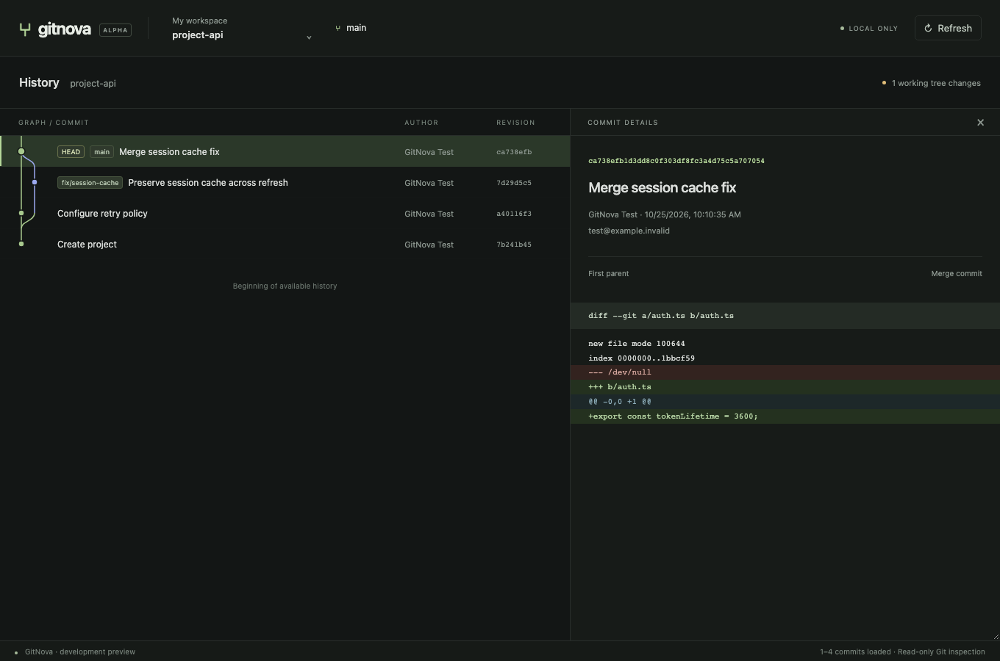

# Foundation and first real Git vertical slice

Verified locally on 2026-10-25, Apple Silicon macOS.

## Delivered

The application opens local Git repositories through application services, computes active graph lanes in Rust, transfers serialized DTOs through Tauri commands, renders a virtualized interactive React graph, and displays selected-commit metadata and a real patch. Workspaces/memberships persist locally; linked worktrees share repository identity. Switching preserves warm selection/scroll context. Direct submodule pointers and linked-worktree navigation live in the existing repository selector.

The architecture and milestone plan incorporate the multi-repository addendum. Core crates have no Tauri dependency. See README.md for the file map and docs/architecture/overview.md for boundaries and deferred work.

## Executed checks

| Check | Result |
| --- | --- |
| `cargo fmt --all -- --check` | Passed |
| `cargo clippy --workspace --all-targets --locked -- -D warnings` | Passed |
| `cargo test --workspace --locked` | 18 tests passed: 14 real Git/domain integration fixtures, 2 layout tests, 1 storage test, 1 Tauri IPC test |
| `cargo check -p gitnova-desktop` | Passed |
| `cargo build -p gitnova-desktop` | Passed |
| `npm run build` | TypeScript check and production Vite build passed |
| `npm test` | 3 tests passed |
| `npm run test:e2e` | 2 Playwright workflows passed |
| `npm audit` | 0 reported vulnerabilities in the installed npm dependency graph |
| `npm run tauri dev -- --no-watch` | Native application launched; macOS registered foreground app plus Web Content process |

The initial machine's Homebrew Rust linker emitted macOS deployment-target warnings (some standard-library objects were built for macOS 13 while a test executable targeted 11). Tests and desktop build completed. This does not establish support for macOS 11/12. Hosted CI, Windows/Linux native builds, installers, accessibility audit and performance benchmarks have not run here.

## Fixture coverage

Multiple repositories and workspaces, persistence/pinning, empty/bare repositories, dirty/detached state, real merge/first-parent/root diffs, pagination continuity and stale cursors, annotated tag labels, shared worktree identity, opening discovered worktrees, submodule HEAD/index/checkout differences, dirty/uninitialized child state, independent nested repositories, SHA-256, shallow clones, symlinks, native-path byte roundtrip, corrupted/missing objects, invalid OID input, disabled external diff/textconv, and real octopus/criss-cross histories with skewed timestamps.

The macOS filesystem rejected invalid UTF-8 directory creation, so the native-path representation is tested without filesystem creation on macOS. A real non-UTF-8 repository fixture is gated to Linux and has not run on this machine.

The Tauri test uses its mock runtime to exercise the actual command handler, argument naming, DTO serialization and remote-origin rejection against a temporary Git repository. Browser workflows emulate the transport and call the real Rust core through a test-only executable. They verify graph/diff rendering, switching/restored selection, keyboard movement, small-window behavior, workspace switching and the explicit desktop-required browser state. They do not certify full native webview interaction.

The screenshot contains generated fixture data from real temporary Git repositories through the browser test transport, not a production user repository or invented graph response.

## Limits and next milestone

This is a read-only slice. Full multi-repo MVP acceptance is still open. No stage/commit/remote writes, submodule initialize/restore, worktree writes, workspace search, smart preview or release integrations are implemented. Direct discovery can navigate child-by-child; recursive submodule discovery and conflict stages are deferred. History/status need manual refresh after external activity. Cached graph context is in memory only. Pages retain a bounded rolling window and deep pagination reruns traversal.

Recommended next: cache invalidation and write coordination, then stage/unstage and commit with validation, operation receipts and dirty-work protection. Subsequent milestones complete safe submodule/worktree operations and workspace-wide search. Do not add dashboard navigation to expose these features.
