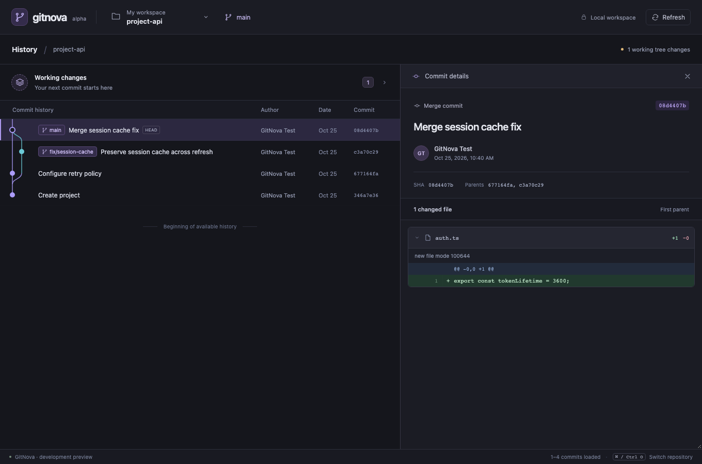
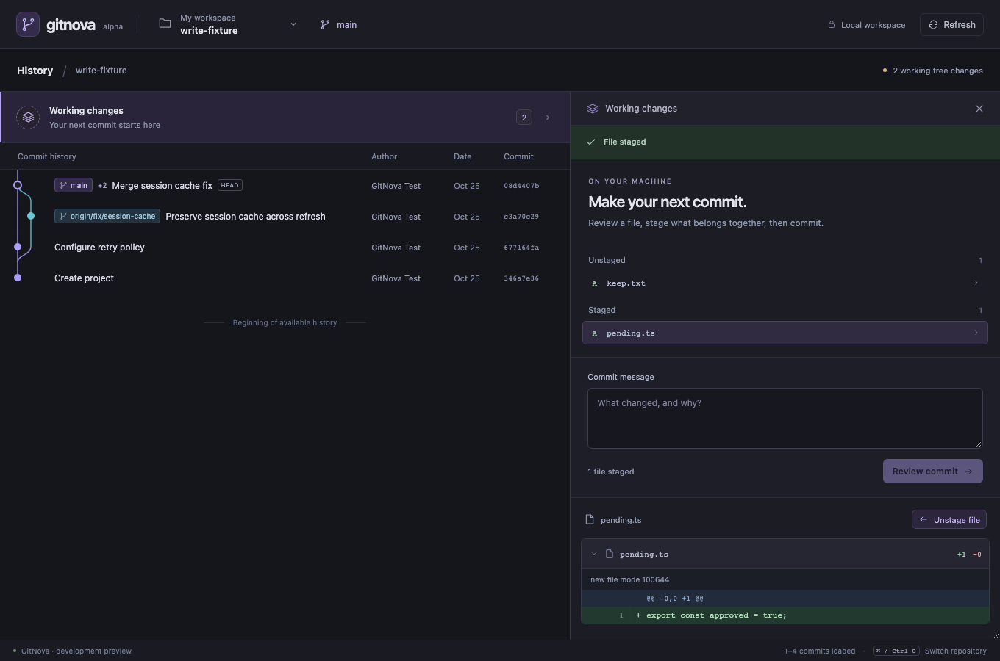

# Visual refinement and everyday Git writes

Verified locally on 2026-10-25, Apple Silicon macOS. This extends the foundation milestone; the full multi-repository MVP remains incomplete.

## Delivered

Graphite/violet visual system with original SVG icons, clearer typography, a compact repository selector, restrained ref labels and a structured commit inspector. Patches are grouped by file with old/new line numbers, addition/deletion counts, collapsible sections and virtualized code rows. The empty state uses an original vector graph illustration. No dashboard or permanent new sidebar.

A Working changes row above history opens the existing contextual detail area. It provides a staged/unstaged file list, real per-file diff, stage/unstage of the selected path, a per-membership commit-message draft, staged patch review and explicit commit confirmation. Unstaged work is preserved. Graph/working status revalidate on focus and every five seconds while visible; cached selection remains available and local writes pause background polling.

Rust adds capability ports for working-tree reads, index writes and commit creation. Native locks plus isolated prepared indexes coordinate writes, SHA-256 tokens reject stale reviews, and persisted receipts record repository/worktree/membership identities, timestamps, resulting HEAD and recovery guidance. Original repository identity is checked before writing. Native configured hooks/signing run during commit; configured filters may run during actual staging. Read previews neutralize clean/process filters as well as external diff/textconv and fsmonitor, and prohibit implicit network protocols.

## Verification

| Check | Result |
| --- | --- |
| `cargo fmt --all -- --check` | Passed |
| `cargo clippy --workspace --all-targets --locked -- -D warnings` | Passed |
| `cargo test --workspace --locked` | 31 tests passed: 14 existing Git/domain integration fixtures, 13 write/cache fixtures, 2 graph tests, 1 storage test, 1 Tauri command test |
| `cargo build -p gitnova-desktop --locked` | Passed |
| `npm run build` | TypeScript check and production Vite build passed |
| `npm test` | 5 tests passed |
| `npm run test:e2e` | 3 workflows passed against temporary real Git repositories through the test-only Rust transport |
| `npm audit` | 0 reported npm vulnerabilities |

Write fixtures cover stage/unstage, preserving unrelated staged paths and working edits, stale file/index/HEAD tokens, existing Git/app locks, first commits and unborn unstaging, deleted files/directories, literal special-character paths, operation-in-progress/path-traversal rejection, configured hook failure, filter-free previews and failing clean filters, truncated commit-review rejection, staged gitlink-removal refusal, receipts and external status changes. Temporary write fixtures isolate hook/attribute configuration from the developer's global Git configuration.

Browser workflows cover graph/diff rendering, repository/workspace switching, restored selection, keyboard navigation, small-window behavior, browser-only limitations, per-file stage/unstage, staged review, real commit creation, preserving an unselected file and cache invalidation after an external commit. The multi-operation scenario has a 90-second test budget; it includes several native Git subprocess pipelines and is not a performance benchmark. A previous concurrent run exhausted its 60-second scenario budget; isolated execution with a completed-write synchronization point passed. Native IPC has a separate mock-runtime command test. Full native webview automation and Windows/Linux execution remain unverified here.

Some local test link steps retain the previously documented Homebrew Rust macOS deployment-target warning. There is no new claim of compatibility with older macOS releases, completed hosted CI or production readiness.

## Screenshots

These use generated fixture content from real temporary Git repositories, not private user data or invented graph responses.

## Key source changes

- `apps/desktop/src/App.tsx`, `styles.css`, `Icons.tsx`: primary visual hierarchy, repository selector, graph context and background revalidation.
- `DiffView.tsx`, `diff.ts`: file-grouped patches, line numbering and bounded rendering.
- `WorkingDetails.tsx`, `api.ts`, `contracts.ts`: working changes, per-file actions and explicit commit review.
- `apps/desktop/src-tauri/src/main.rs`, `crates/gitnova-ipc`: typed command boundary.
- `crates/gitnova-domain`, `gitnova-git/src/working.rs`, `gitnova-core`: snapshot contracts, safe index preparation, Git execution coordination and receipts.
- Rust integration fixtures, browser workflows, diff parser tests, refreshed icons, README, ADR and UI surface budget.

See [ADR 0002](adr/0002-reviewed-index-writes.md) for index-lock, filter and concurrency decisions.

## Limits and next step

No stage-all, hunk staging, amend, discard, conflict resolution, checkout, network writes or submodule/worktree writes. File/index/path/diff/write-time budgets remain explicit. Incomplete commit previews cannot be approved. Hooks can change content or external state; read preview is not a sandbox for subsequent configured hook execution. Raw filter-free working-file views can differ from normalized index content. Arbitrary external ref/filesystem edits are not part of an atomic application transaction.

Operation receipts are persisted under app data; there is no recovery-history UI yet. Stale locks are never automatically removed. Windows child-tree cleanup, native cross-platform workflows and crash recovery need further work. Polling/native subprocess cost on large repositories is a priority for the next milestone; no latency or FPS target is claimed.
