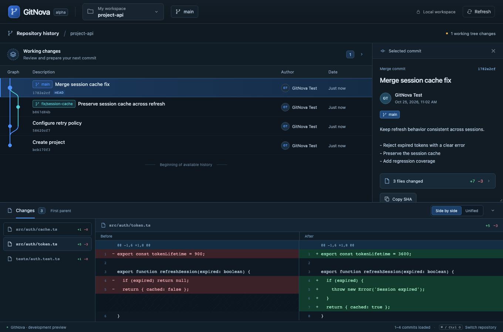
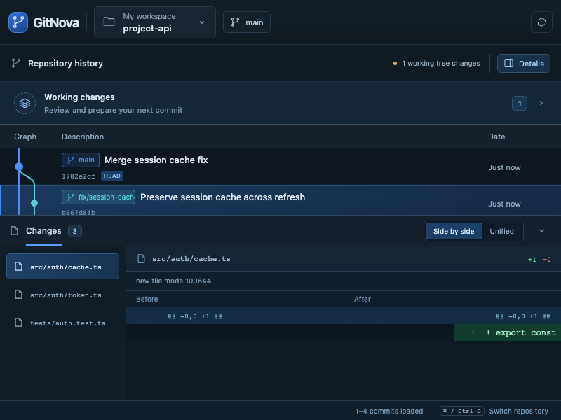

# Reference-led graph, inspector and diff layout

Verified locally on 2026-10-25, Apple Silicon macOS.

## Result

The supplied visual draft informs the blue-black surfaces, blue selection states, colored graph lanes, author initials, description/author/date hierarchy and pane proportions. The existing workspace/repository selector remains the entry point. No additional permanent application sidebar or unsupported feature navigation is introduced.

The selected commit's metadata is on the right, and its patch moves to a bottom dock spanning the workspace. The dock provides a changed-file list, selected-file patch, real side-by-side and unified rendering, old/new line numbers, counts and truncation notice. Its existing header can collapse/expand without clearing the commit, selected file or code scroll. A pointer/keyboard resize separator adjusts its height, retained across commit changes. Metadata can close independently; a restore control appears in graph context only while it is hidden.

The commit inspector shows the actual commit message, author, refs, OID, parents and comparison. Its changed-file summary restores the existing diff context. Copy SHA writes the exact selected OID to the system clipboard through the webview clipboard API; unavailable clipboard access has an explicit selectable-SHA fallback. Author avatars use local initials, with no remote images.

## Implementation

- `History.tsx`: extracted virtualized history, stronger lanes/nodes, matching ref colors, author initials, dates and 52 px rows. Rust traversal/layout data remains unchanged.
- `CommitInspector.tsx`: focused metadata and local SHA copying.
- `CommitDiffDock.tsx`: contextual file selection, side-by-side/unified patch rendering, bounded code viewport, collapse/restore and keyboard/pointer resize.
- `diff.ts`: alignment of adjacent removed/added runs, unequal run lengths and no-newline markers while preserving original line numbers.
- `App.tsx`: upper graph/inspector and lower diff composition; retains workspace, cache and working-write integration.
- `styles.css`, `Icons.tsx`, original SVG and generated desktop icons: coherent blue theme, hierarchy and compact-window layout.
- Tests, README and the UI surface budget document the actual supported behavior.

This is a presentation change to existing Git data. Side-by-side display does not simulate a merge, resolve conflicts or establish semantic safety. The existing reviewed stage/unstage/commit workflow is preserved.

## Verification executed

| Check | Result |
| --- | --- |
| `npm run build` | TypeScript check and production Vite build passed |
| `npm test` | 7 tests passed |
| `npm run test:e2e` | 3 real-core browser workflows passed, including the existing write workflow |
| Targeted `real history` workflow after final layout refinements | Passed |
| `cargo build -p gitnova-desktop --locked` | Passed |

The browser workflow now also checks old/new patch content, changed-file switching, side-by-side/unified controls, collapse preserving commit/file selection, keyboard resize, height retention across commits, copy-SHA correctness, independent metadata restoration and an 800 × 600 window without document overflow. Richer fixture patches come from actual commits in temporary Git repositories. They are not hard-coded graph/API responses.

The Rust engine was not changed or unit-tested again for this presentation milestone. The separate test-only transport exercises the real Rust core, not the native webview transport. Full native webview automation, Windows/Linux validation and performance benchmarks remain outside this verification.

## Screenshots

The screenshots use generated fixture content from real temporary Git repositories and contain no private user source.

## Remaining work

Universal search, remote operations and advanced change intelligence remain on the existing roadmap. This layout exposes working capabilities only. Long or binary patches retain the existing read budgets and incomplete-preview indicators. Native clipboard availability depends on the webview/OS; the selectable full OID remains available.
