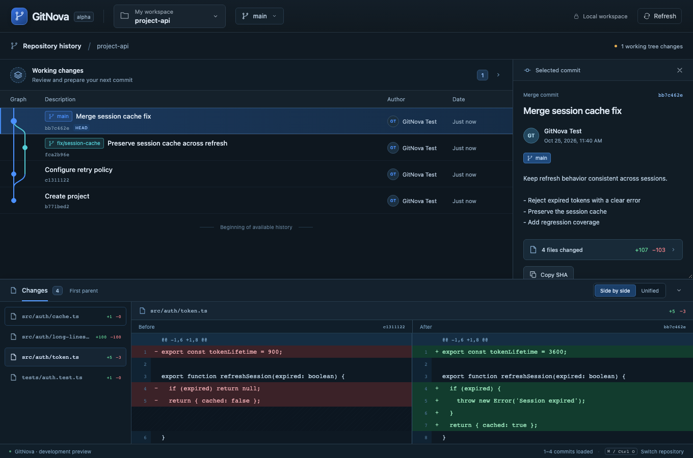

# Local branch switching and fixed Before/After comparison

Verified locally on 2026-10-25, Apple Silicon macOS.

## Delivered

The current-branch label is now an actual selector. It lists and filters existing local branches, identifies the current/occupied branch, previews the source/target and affected paths, and requires explicit switch confirmation in the same popover. The application uses native Git switch, refreshes graph/status, selects the resulting HEAD and persists an operation receipt.

Switching currently requires clean work. It rejects existing locks, occupied linked-worktree branches, stale previews, active merge/rebase/cherry-pick/revert states, hidden-index flags and submodule pointer changes. Detached work must be directly preserved by a local branch before switching. Native Git is called without force, stash, recursion, remote guessing or ignored-file overwrite. Configured checkout hooks and filters run only during explicit execution. No user repository was switched by implementation tests; all write fixtures were temporary.

Split diffs now use two equal-width fixed panes. Before/After headings identify actual compared revisions and remain above the scroll containers. Each side scrolls horizontally on its own, the center divider stays fixed, and vertical offsets remain synchronized over aligned patch rows. Line gutters remain visible. Full-file widths are measured/cached so virtualization cannot collapse the horizontal range when a long line scrolls out of view.

## Verification

| Check | Result |
| --- | --- |
| `cargo fmt --all -- --check` | Passed |
| `cargo clippy --workspace --all-targets --locked -- -D warnings` | Passed |
| `cargo test --workspace --locked` | 38 tests passed, including 7 new branch fixtures |
| `cargo build -p gitnova-desktop --locked` | Passed |
| `npm run build` | TypeScript check and production Vite build passed |
| `npm test` | 7 tests passed |
| `npm run test:e2e` | All 5 real-core browser workflows passed |

Branch fixtures verify real worktree/HEAD changes, preview non-mutation, dirty/staged work preservation, changed target refs, another worktree holding the branch, native/app locks, ignored-file overwrite protection, gitlink refusal, revision-expression rejection, checkout hooks and assume-unchanged safety. Browser coverage additionally confirms local-branch UI confirmation and dirty-work rejection, equal pane widths, stable center/header geometry, independent horizontal offsets, vertical synchronization and offset retention after the longest line is virtualized out.

The existing stage/unstage/commit and workspace/graph workflows also pass. The browser transport uses the real Rust core with temporary Git repositories but does not certify native webview automation on every OS. Existing local macOS linker deployment-target warnings remain as documented in earlier milestones. Windows/Linux native execution and performance targets are not newly claimed.

## Changed source

- `gitnova-git/src/branches.rs`: branch reader/writer ports, local branch inspection, snapshot-bound preview and native switch execution.
- `gitnova-domain`, `gitnova-core`, `gitnova-ipc`, desktop command host and test bridge: typed DTOs, operation coordination, receipts and IPC commands.
- `BranchSwitcher.tsx`, `App.tsx`, `api.ts`, `contracts.ts`: branch popover, confirmation and resulting context refresh.
- `CommitDiffDock.tsx`, `styles.css`: fixed comparison panes, sticky gutters, synchronized scrolling and stable virtualized widths.
- Branch integration fixtures, browser regressions, README, UI surface budget and [ADR 0003](adr/0003-local-branch-switch-and-fixed-diff.md).

## Scope

Existing local branches only; branch creation and remote tracking remain future work. Dirty work is not automatically carried, stashed or discarded. Arbitrary external filesystem/ref changes are not part of an atomic application transaction. Hook/filter side effects and partial outcomes remain explicit Git execution/recovery concerns.
