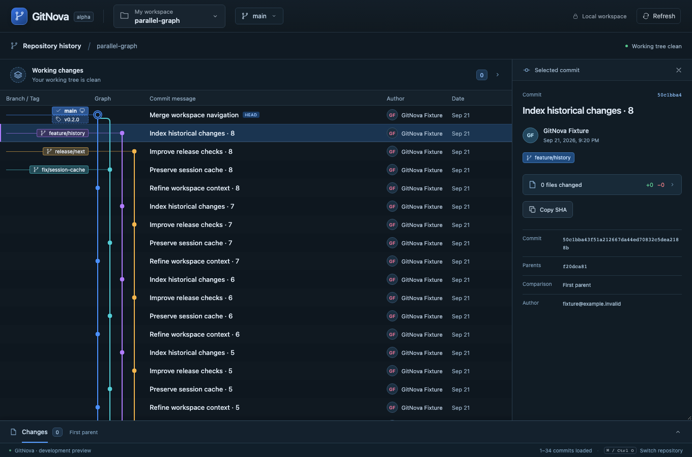

# Milestone 05 — Parallel branch graph readability

The graph now presents parallel development clearly in the existing history context. Branch / Tag labels have their own column before the colored lanes; commit messages occupy compact 36px rows. Matching local/remote names at the same revision share a badge, while tags and divergent remote tips remain distinct. Full names remain available in tooltips and the selected-commit inspector.

History uses date-order traversal with children ahead of parents, revealing parallel tips earlier than the previous branch-at-a-time traversal. Sparse lane positions and separate color identities persist through pagination. Finishing a line no longer moves or recolors surviving lines. The checked-out revision reserves the first lane; explicit incoming strokes avoid invented connections above branch tips. Rounded edges, hollow merge nodes, HEAD rings and a subtle reference connector make topology easier to follow. Colors represent loaded history lines, not immutable branch identities.

No new screen, sidebar, dialog or navigation item was introduced. Existing keyboard selection, per-repository context, virtualization and the resizable fixed-pane diff remain in place. The graph's horizontal scroll also moves its column headings on narrow windows.

## Validation

- `cargo test --workspace`: 42 tests passed, including a real 121-commit parallel-history fixture crossing the 100-commit page boundary.
- `cargo fmt --all -- --check` and `cargo clippy --workspace --all-targets -- -D warnings`: passed.
- Frontend production build and 8 Vitest tests: passed.
- `npm run test:e2e`: all 6 real-core browser workflows passed, including branch switching, fixed split diffs and the new parallel graph. These use actual Rust/Git results from temporary repositories, with an emulated browser transport.
- Native macOS host rebuilt and launched with the new DTOs. Existing deployment-target linker warnings remain; Windows/Linux native behavior is not newly certified.

Graph unit coverage checks octopus merges across every pagination split, criss-cross merges, disconnected roots, reserved HEAD and stable surviving lanes. Browser graph coverage checks real parallel branches, co-located refs/tags, merge and HEAD markers, 36px rows, stable lane/color identity, narrow-window containment and heading scroll alignment. Existing branch switching and split-diff regressions remain part of the full browser suite.

See [ADR 0004](adr/0004-stable-parallel-graph.md). Offset pagination still re-runs Git traversal; palette colors cycle for sufficiently many concurrent histories, and sparse lanes can require horizontal scrolling.

