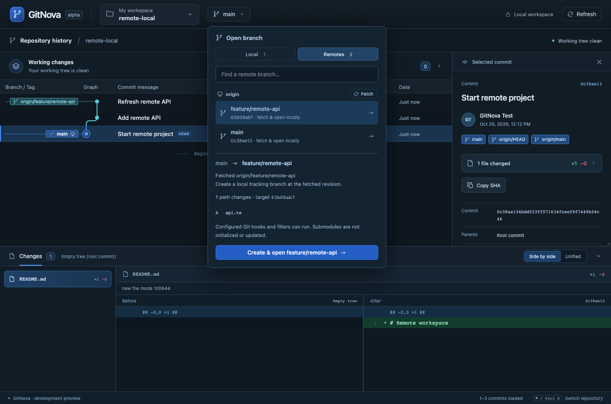
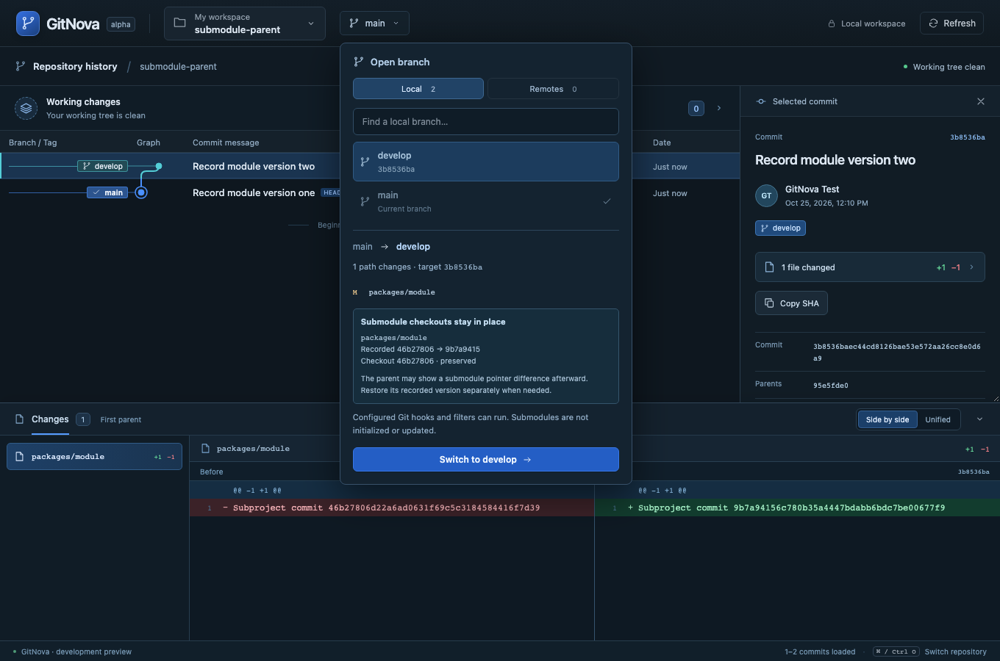

# Milestone 06 — Remote branches and submodule-aware switches

The branch picker now includes Local and Remotes scopes. Remotes are read from the actual Git configuration and cached remote refs; symbolic aliases are omitted. A per-remote Fetch discovers missing heads. Selecting a remote branch fetches its latest revision and reviews creating a local tracking branch or switching to and fast-forwarding its existing local branch. One confirmation completes the local action. A local branch ahead of remote retains its commits; divergence, different upstreams, dirty work and occupancy in another worktree block integration.

Remote fetch and local integration have separate persisted operation receipts. Fetch does not change local branches or files. Integration uses the fetched, reviewed OID without another network request. Errors report partial state and recovery; operations are not atomic and are never retried or rolled back automatically. Authentication uses Git's configured credentials / SSH agent, with terminal prompts disabled. There is no credential setup UI or push in this milestone. Fetch is heads-only and nonrecursive, does not prune or download tags, and ignores extra configured refmaps. Standard file/HTTP(S)/SSH/Git transports are allowed; custom helpers are excluded.

The screenshot's branch-switch refusal is addressed for pointer-only submodule changes. Preview shows recorded old/target and actual checked-out revisions. Confirmed nonrecursive switching changes the parent branch/index while preserving child checkouts, including local unpushed child commits. The parent honestly reports any resulting unstaged gitlink mismatch. Switching back works while clean child checkouts differ from recorded pointers. Child dirty content, staged work and submodule add/remove/type replacement remain blocked; this is not an initialize/restore-submodule implementation.

Graph layout and fixed Before/After panes remain unchanged. No permanent navigation surface was added. Repository switching and refresh are disabled while the branch picker performs a write, and fetch refresh preserves the selected graph context.

## Verification

- Rust workspace suite: 51 tests passed. An additional focused fetch-isolation regression passed with explicit no-prune-tags and configured tag/prune overrides.
- Frontend production build and 8 Vitest tests passed.
- All 8 browser workflows passed across the suite and focused rerun: the full run passed 7, while the remote integration assertion hit its 15-second wait during concurrent Rust testing. The rerun explicitly waits for the operation to finish before inspecting the branch and passed in 57.8 seconds. Fixture cleanup now waits for active bridge requests instead of removing repositories during a write.
- Formatting and strict workspace/all-target Clippy passed. Native macOS host rebuilt with the new commands.

 Tests use temporary real Git repositories and local remotes. Browser tests emulate IPC transport while reading and writing through the actual Rust core. Windows/Linux native execution and interactive authentication are not newly certified. Existing macOS linker deployment-target warnings remain.

Coverage includes selected/all-head fetch isolation, remote-only local creation and upstreams, current and switched local fast-forwards, ahead and divergent histories, dirty work preservation, linked worktree occupancy, stale remote/configuration previews, failed transport recovery, rejected custom protocols and checkout-hook interference. Submodule coverage preserves clean/unpushed child revisions across parent switches and verifies dirty-content refusal. Browser coverage exercises remote discovery, latest-revision fetch on selection, create/open/pull, pointer preview and switching back with a retained child checkout.

See [ADR 0005](adr/0005-remote-branches-and-parent-switches.md) and the [surface budget](ux/surface-budget.md).

