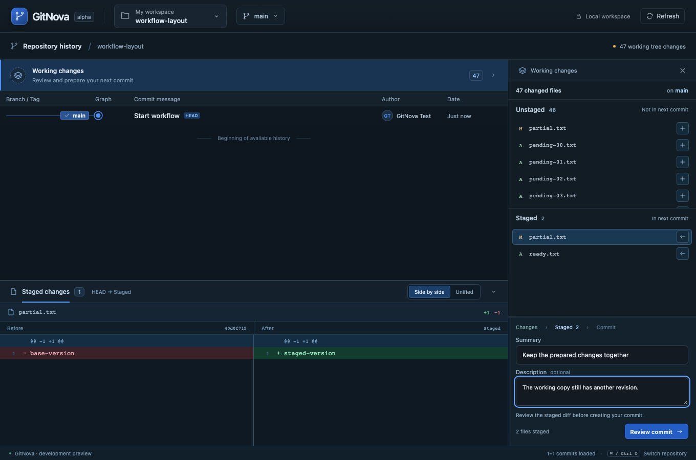
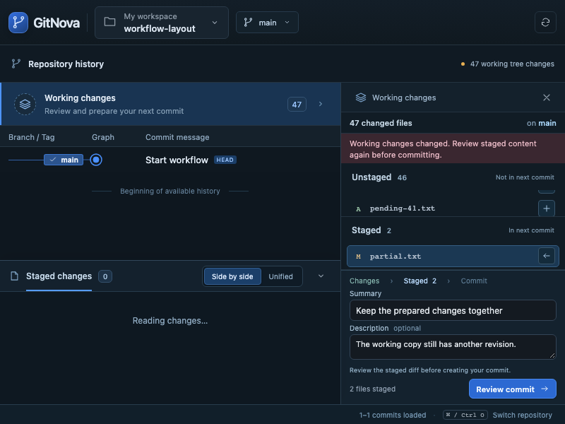

# Milestone 07 — Workflow clarity and the next commit

Product direction: make workflows easy to understand and ordered, and carry the principle through future GitNova development. The [workflow contract](ux/workflows.md) and root [AGENTS.md](../AGENTS.md) now record that product rule. All UI code, icons and interaction structure are original.

The working inspector now presents branch context, two persistent Unstaged / Staged groups, and a stable commit composer. Group subtitles distinguish content outside the next commit from content included in it. Each group scrolls independently, preserving the other group's heading. A partially staged path appears in both groups with scope-specific selection and operations.

The existing diff dock now also displays working and staged patches, with correct Index / Working tree or HEAD / Staged comparisons. It reuses fixed 50/50 panes, synchronized vertical scrolling and independent horizontal scrolling. The working inspector spans the graph/diff height; its composer stays at the bottom while code is inspected or resized. File-row stage/unstage actions replace the old action below the composer. They still validate backend file preview tokens and use real Git writes.

Summary and optional Description compose the same per-repository draft. The primary action explains missing staged content or summary, then transitions to staged review in the same layout. During review, selecting an included staged file updates the dock without exiting review. Back to changes preserves the draft; confirmed commit includes staged content only. A changed working snapshot invalidates review, and truncated previews keep confirmation disabled. Success/error messages remain scoped and compact. No additional screen, sidebar, dialog, bulk stage, discard or amend feature was introduced.

Existing workspace, graph, branch/remote and related-repository flows were audited using the common context → scope → preview/action → result contract; the workflow matrix documents how their existing surfaces already carry that sequence. This is a durable design rule, not a claim that every planned Git feature is implemented.

## Verification

Frontend production build and all 8 Vitest tests passed. All 9 real-core browser workflows passed in one complete run (3.1 minutes), including existing graph, remote integration, submodule switches and split-pane regressions. The new workflow test additionally verifies both versions of a partially staged path, included-file selection during review, stale review invalidation, fixed action placement, 45 unstaged paths, 800×600 containment and per-repository draft restoration. This change does not alter Rust/Git mutation behavior or IPC contracts. Existing backend verification remains documented in milestone 06; new checks focus on real-core browser workflows and frontend build/tests. Browser tests use temporary real Git repositories and an emulated IPC transport, not native webview automation on every OS.

Coverage: stage/unstage/commit, summary/body preservation, staged-versus-working revisions of one file, unstaged exclusion, selection during multi-file review, stable action placement, long file groups, narrow windows, stale staged review, empty groups and drafts scoped to repositories. Existing graph, local/remote branch and fixed split-diff workflows remain regression checks.

