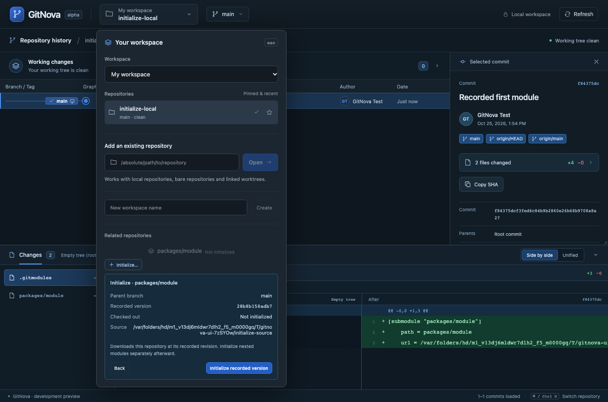
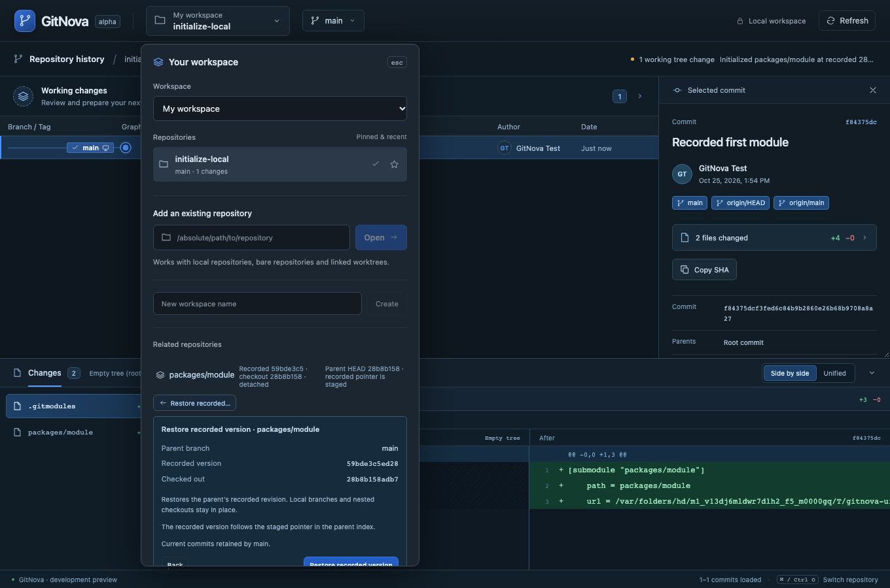

# Milestone 09 — Recursive submodules and recorded checkouts

Submodule discovery now follows initialized descendants with explicit stable parent/child relation IDs and containing/child repository and worktree identities. New identities are persisted without silently adding workspace memberships. Discovery guards paths through symlinks, repeated worktrees/cycles, more than 256 relations and depth beyond eight. Missing/uninitialized states remain visible; unavailable inspection is not presented as a clean worktree. Related repositories are discovered when their existing picker is opened or regains focus, keeping the main graph load independent of this work.

The existing related-repository item now hosts Initialize and Restore recorded preview/confirmation. The preview identifies containing branch, recorded INDEX revision, actual checkout, source and relative-URL base where relevant. Initialize downloads only the selected child at its recorded revision via native Git's explicit checkout strategy. Nested children are discovered afterward and initialized through separately reviewed actions. Restore checks out the reviewed local OID without requesting a fetch, forcing, staging the parent or recursing. Actual configured checkout hooks/filters can run; preview does not run them or custom update commands.

Parent and selected-root index guards, common-directory operation guards, before/after HEAD/index snapshots and target postconditions protect coordinated operations. Dirty child work, hidden index flags, active operations/locks and detached commits without a retaining local branch block restore. Ignored files are protected by native no-overwrite-ignore checkout. Parent staged gitlinks remain staged after restoring their index revision. Receipts record the relation/path, containing and child identities, expected target and actual child heads; failure can leave downloaded objects/registration and is reported without rollback or automatic retry.

Limits are explicit: existing cached module metadata cannot be blindly reinitialized, nonempty destinations are protected, and a restore target missing locally requires a separate child fetch. Restore recorded version is distinct from updating to a newer configured remote branch. Add/remove/sync-URL, automated remote-version updates and worktree creation/removal remain deferred. The multi-repo MVP is still open until workspace-scoped commit search and remaining acceptance gates are implemented. This increment does not claim atomic operations across repositories.

See [ADR 0006](adr/0006-recorded-submodule-checkouts.md) and the [surface budget](ux/surface-budget.md).

Validation on macOS, 2026-10-25: all 64 Rust tests passed, including eleven submodule integration cases and source-redaction coverage. Format check, strict workspace/all-target Clippy, 13 frontend tests and production build passed. All 13 real-core browser workflows passed in 4.3 minutes, including initialize → staged pointer → restore → child graph and existing branch/remote/working/diff regressions. Test writes used temporary Git repositories and local remotes. Browser transport is emulated; native webview automation, other operating systems and release packaging remain outside this verification.

Linked-worktree coverage additionally initializes an independent child checkout while the primary worktree already has one, then verifies cached metadata retains an unpublished child commit and blocks blind reinitialization. Admin paths come from Git itself.

Preview safety also covers filters configured only in child repositories: parent status and working-tree patch reads collect and neutralize descendant filter drivers using metadata-only inspection. A real-Git regression modifies a filtered child file with unchanged byte length and a changed timestamp, then verifies parent status, working changes and restore preview never execute its clean command. This read-safety traversal fails closed beyond 256 children or 16 levels and rejects symlinked gitlinks. Offline reads disable every transport protocol.
