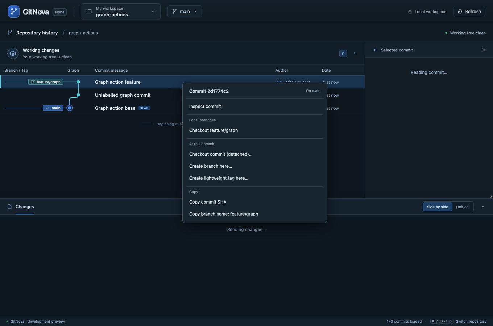
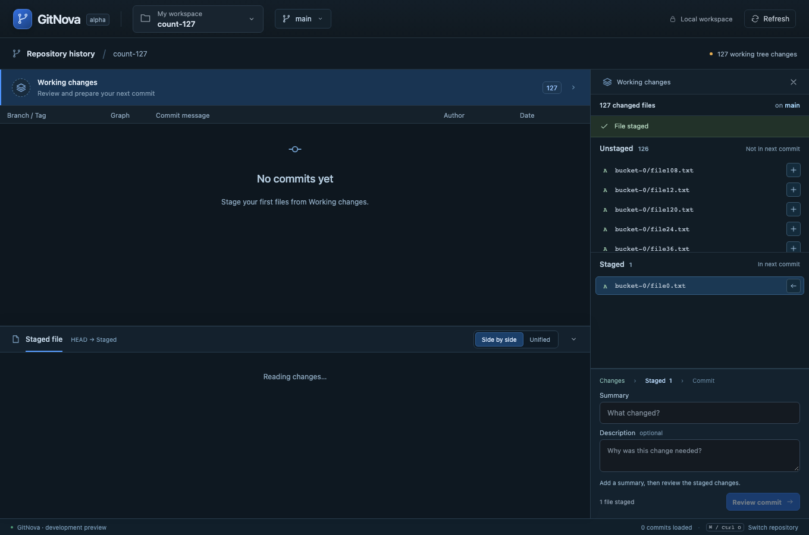

# Milestone 10 — Working count and direct graph actions

Fixes the reported 12-versus-127 discrepancy: status previously collapsed untracked directories while the inspector expanded files. Both now explicitly enumerate untracked files using the same rename-disabled path representation. One path with staged and unstaged content counts once in the total. Empty history reports zero commits loaded.

Right click or Shift+F10 on a commit opens scoped actions in the graph. Local and remote refs identify exact branches; double click on a branch badge targets that ref. A node with multiple branches shows choices; a unique local branch opens its preview, a sole remote branch fetches and prepares local integration, and an unlabeled node previews detached checkout. Confirming remote integration retains the existing tracking/fast-forward-only behavior.

Added real checkout-commit, create-and-open branch and lightweight-tag operations, with core preview tokens, no-force native Git commands, ref-name validation, local exact OIDs, dirty/ignored/hidden-index/lock protection, parent-pointer preservation and durable action receipts. Detached ancestors retained by a local branch can be left; unretained commits remain protected, and creating a branch at the current detached OID can preserve them. Tag creation preserves checkout/index and cannot overwrite a racing ref. Contextual evidence, confirmation, error recovery, keyboard navigation and viewport placement use the existing graph context.

The [coverage plan](ux/graph-actions.md) identifies every important action family from the reference and its remaining backend work. Push/upstream editing, merge/rebase/conflict flows, reset/revert/cherry-pick, rewriting, deletion, annotated tags, patch export and hosted-provider integration are not implemented by this increment. They are not exposed as inert menu items. See [ADR 0007](adr/0007-graph-context-actions.md).

Full regression also exposed a same-size staging defect: copying an index with a later timestamp could make a racy cached stat entry appear clean. Alternate-index preparation and publication now preserve native index modification timestamps. A deterministic regression with matching coarse stat fields verifies the selected content is staged and unrelated staged content survives.

Validation on macOS, 2026-10-25: format check and strict workspace/all-target Clippy passed; all 72 Rust tests, 13 frontend tests and production build passed. All 16 browser workflows passed against the real Rust core and temporary Git repositories (5.5 minutes). A subsequent focused graph-action rerun also passed after adding finite row-based fallback coordinates for events without mouse positions, actual viewport-edge MouseEvents and a no-browser-errors assertion. Browser transport is emulated; native webview automation and other operating systems remain unverified. Real-Git regressions cover the 127-file count, mixed staged/unstaged path counting, rename consistency, preview immutability, detached preservation, name/target/stale-review rejection, dirty/hidden/locked/ignored files, tag preservation/collisions and checkout-hook postconditions. Browser coverage includes graph gestures, keyboard ambiguity/selection, branch/tag creation, remote checkout and viewport placement.

