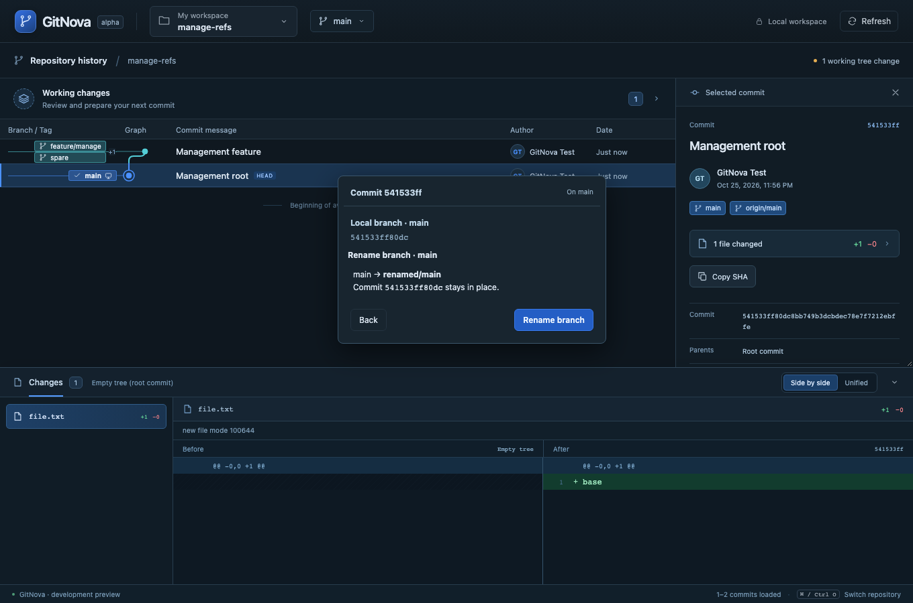
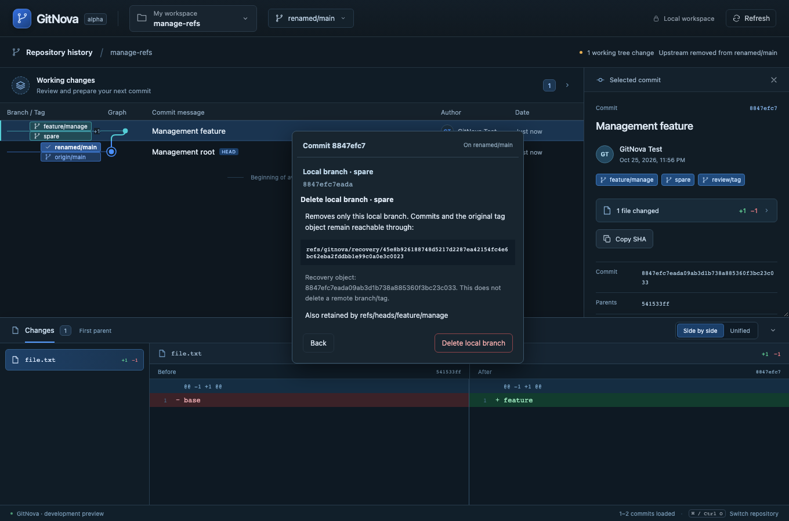
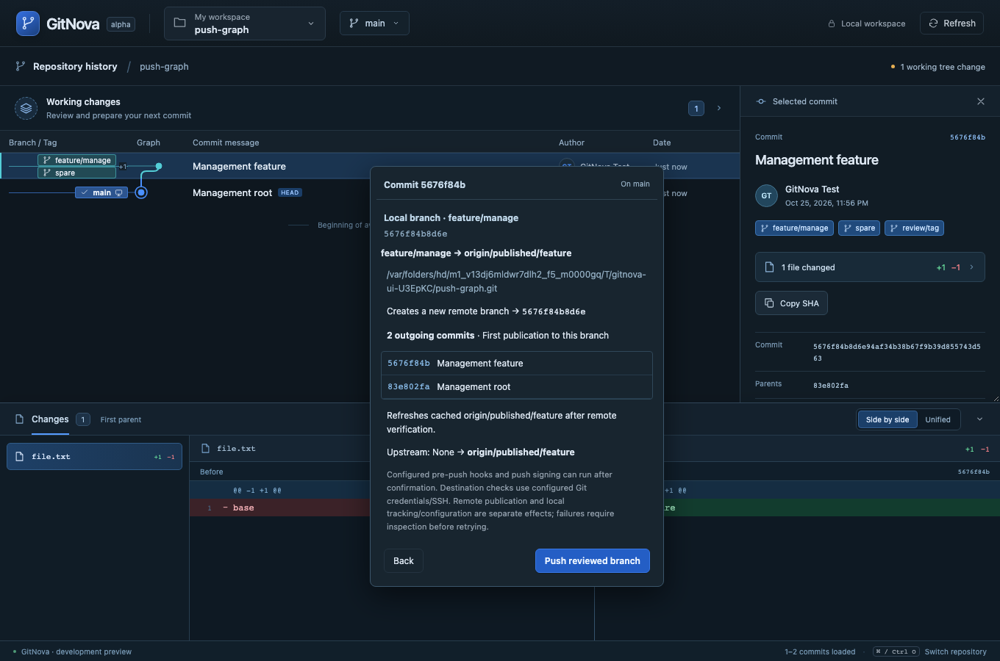
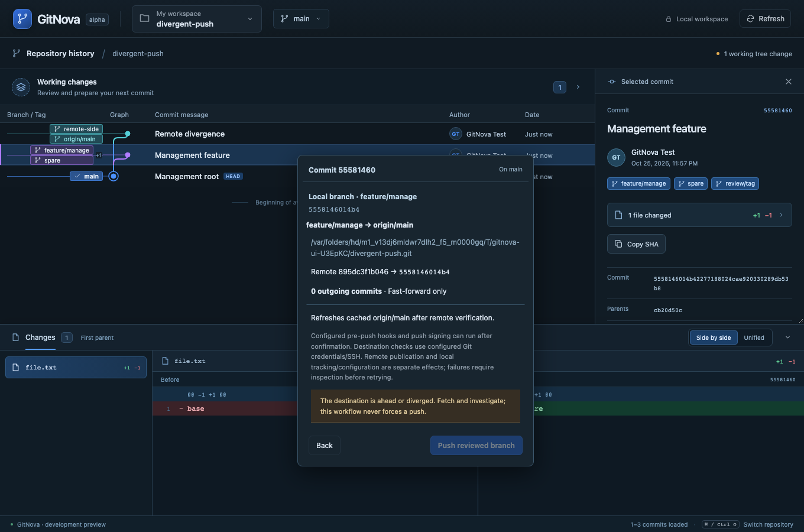

# Milestone 11 — Ref lifecycle, upstream and reviewed push

The graph's existing context menu now offers Manage branch/tag. Its existing inline form and review surface handle rename, recoverable delete, upstream configuration and publication. No new screen, sidebar, dashboard or permanent toolbar was added. Source branch and destination stay explicit when a different branch is checked out.

Native branch rename retains config/reflog and dirty files. Current/other-worktree branch deletion is blocked; local deletion retains an unpublished tip or exact annotated tag object in a disclosed recovery ref using an expected-OID native ref transaction. Normal graph history omits these internal recovery roots. Upstream settings are independently reviewed and never implicitly pull or push.

Push checks the live destination, shows the complete outgoing list up to 500 commits and confirms one pinned non-force branch update. No tags or child repositories are published. Matching standard fetch mappings can receive a guarded cached-tracking update; upstream setup is optional and explicit. Partial-failure receipts distinguish publication from local cache/configuration and retain target evidence. Unsupported/custom/multi-destination configurations and same-repository destinations stop with recovery guidance.

Validation completed on macOS, 2026-10-26: the full macOS Rust workspace suite passed 91 tests; one subsequently added parent/submodule push regression also passed against the unchanged implementation (92 distinct Rust cases covered). Format check, strict workspace/all-target Clippy, 13 frontend tests and production build passed. All 19 real-core browser workflows passed in 6.7 minutes, including keyboard access to tag annotations, visible recovery copying, first publication/upstream and divergence blocking. Browser IPC is emulated while Git results come from the actual Rust core; native webview automation, other operating systems, remote-name-specific hooks/LFS and release packaging remain unverified. Focused real-Git and browser workflows cover these operations; all writes are confined to temporary repositories and local bare remotes. See [ADR 0008](adr/0008-ref-lifecycle-and-push.md) and the [coverage plan](ux/graph-actions.md). Remaining work includes merge/conflict/rebase/cherry-pick/revert, workspace search/worktree lifecycle, hosted-provider actions and release/native cross-platform hardening.

