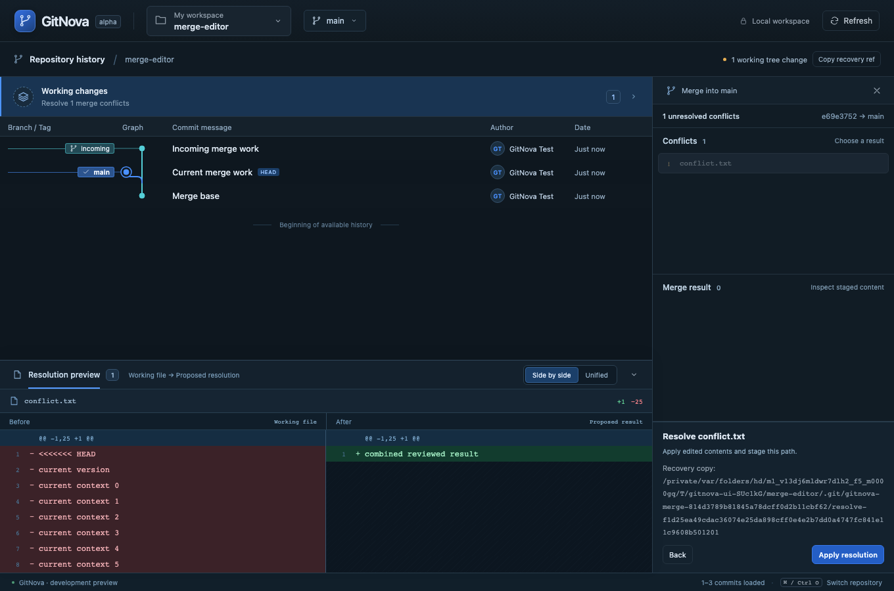

# Milestone 12 — Reviewed merge and conflict resolution

A selected graph commit/ref now offers **Merge into the current branch**. The same graph context shows its source, destination, predicted file effects and conflicts. Fast-forward has explicit confirmation. A divergent merge pauses before commit and opens the existing Working changes inspector; no dashboard, permanent navigation or additional code panel was introduced.

The inspector separates conflicts from merge results. Select a conflict, inspect its actual working diff, choose current/incoming content (including deletion), or edit supported UTF-8 text beside the current branch in the existing equal-width diff dock. Resolution has its own proposed-result review before writing and staging. Finishing requires a review of the complete actual staged tree and an explicit two-parent commit. The message draft survives inspector navigation within the active app session.

Review abort lists affected paths and the private recovery location. Confirmed resolution/abort capture working contents, staged blobs, raw index and merge metadata before changing them. Original and incoming tips remain under disclosed recovery refs. Native abort can refuse unusual edited states; there is no force-reset fallback. Unknown/partial outcomes remain visible with recovery guidance. Externally started or altered merges remain inspectable without automatic adoption.

Prediction uses a scratch bare object store and read-only source alternates. Custom drivers, renormalization, unrelated histories, dirty/hidden work, duplicate branch checkouts and gitlink changes are refused in this first slice. Linked worktree ownership uses its Git directory. Relative attributes and object-store paths containing spaces, colons and Unicode are covered by real-Git regressions. Complete prediction, patch and backup budgets stop unsupported large cases. See [ADR 0009](adr/0009-owned-reviewed-merges.md) for constraints and manual recovery guidance.

Background snapshot responses now reject out-of-order results. Native unmerged diff announcements no longer appear as a fictitious extra changed file. Resolution review labels identify **Working file → Proposed result**, independently of the editor's **Current branch → Editable result** context.

Validation on macOS, 2026-10-26: the full Rust workspace passed 107 tests. The 15 merge regressions passed again after the final proposed-tree binding change. All 21 real-core browser scenarios passed in a complete run; 14 frontend unit tests, production build, formatting and strict workspace/all-target Clippy also passed. Both focused real-core merge browser workflows passed again after the final proposed-tree/editor changes, including unequal-length editor scrolling, edited-result review/finish and saved-edit abort/fast-forward. Browser transport is emulated; operations use the actual Rust core and temporary repositories. Native webview automation, Windows/Linux and hooks/filters/LFS compatibility remain unverified. The multi-repository MVP remains open: clone, workspace-wide search, worktree lifecycle and the remaining submodule operations are still required. Cherry-pick/revert/rebase and history rewriting remain tracked in the [graph-action coverage plan](ux/graph-actions.md).

