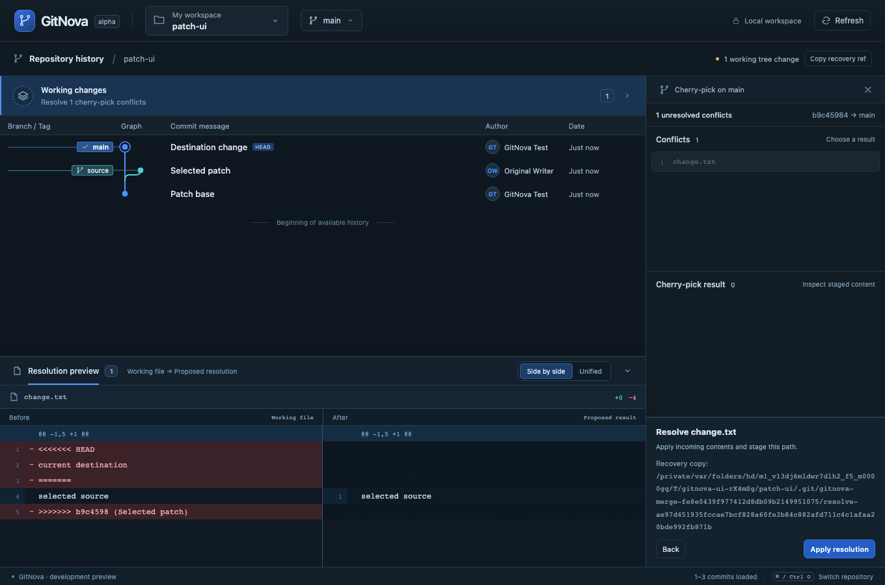
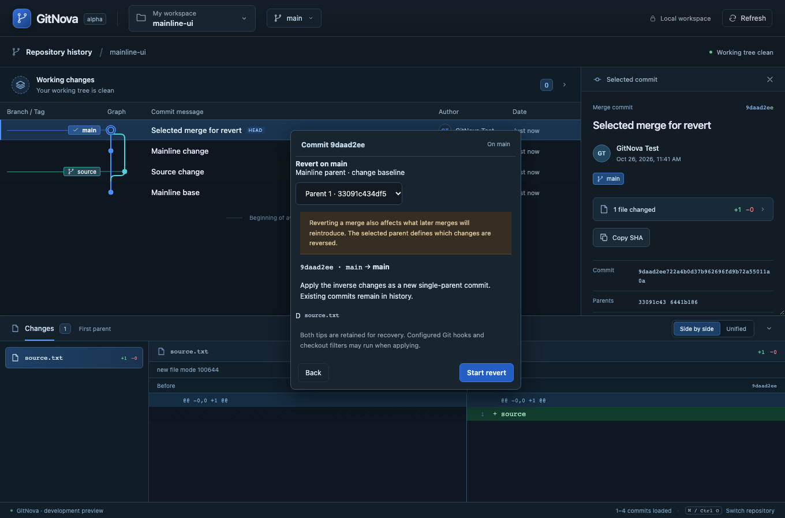

# Milestone 13 — Cherry-pick and revert from the graph

Right click a commit and choose Cherry-pick onto the current branch or Revert on it. The graph's existing review identifies the source, destination and affected files/conflicts. Merge commits require an explicit mainline parent. Cherry-pick imports only the selected delta; revert applies inverse changes as a new commit, retaining the existing history.

Both operations pause in the existing Working changes inspector before committing. Reuse conflict version selection/editing, proposed-result review and the shared bottom diff dock. Revert labels its incoming side Use pre-commit version. Final staged review creates a single-parent commit; cherry-pick retains the original author and author date. The inspector retains operation and mainline context. Ordinary write APIs are blocked while a clean or conflicted owned operation is pending.

Abort review discloses the original checkout and private saved-edit location. Confirmed abort snapshots work/index/staged blobs before an explicit native reset --merge restoration to that retained original tip. It never uses a hard reset or forced fallback. If Git refuses staged/unstaged edits, the contents and recovery data remain available with honest failure guidance. Source/destination recovery refs and operation-aware durable receipts survive partial results. Older merge requests/markers remain compatible, and the UI refuses to apply a new operation when connected to an older native backend that does not acknowledge its operation kind.

See [ADR 0010](adr/0010-reviewed-cherry-pick-and-revert.md) for prediction, ownership, constraints and recovery. This increment supports one commit at a time, including root commits and explicitly chosen parents of merge commits. Shallow histories, empty results, unreviewed gitlink changes, oversized drafts/previews, custom drivers and protected local work stop with an explanation. No new navigation surface was added.

Validation on macOS, 2026-10-26: the full Rust workspace passed 119 tests. The subsequently added shallow-boundary guard passed its focused real-Git regression (120 distinct Rust cases covered). All 23 real-core browser scenarios passed in a complete run, including cherry-pick conflict resolution/authorship, inverse revert and explicit merge-mainline/abort. Production build, 14 frontend unit tests, formatting and strict workspace/all-target Clippy passed. All mutating fixtures are temporary real repositories. Browser tests use the actual Rust core through an emulated transport; native webview automation and Windows/Linux remain unverified. Rebase, history rewriting, clone, workspace search, worktree lifecycle and remaining submodule operations are still on the roadmap; this does not complete the multi-repository MVP.

