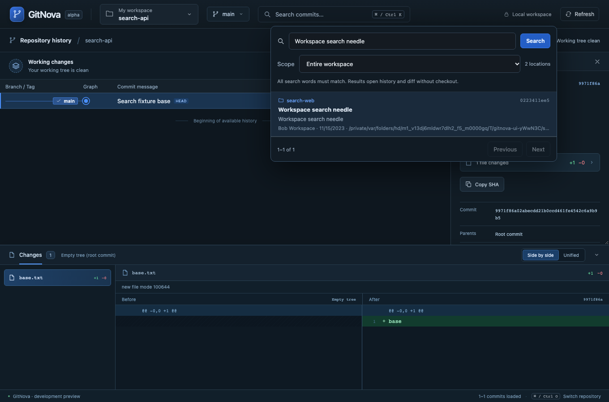
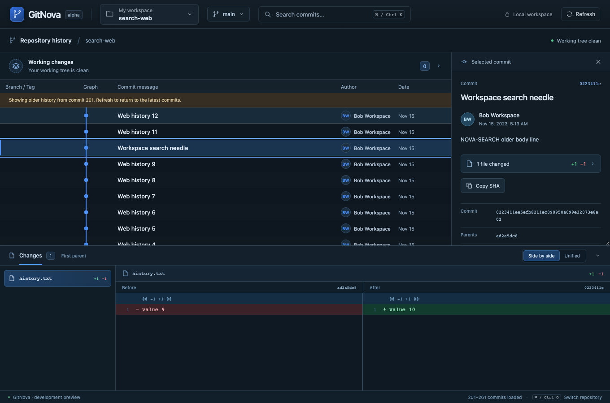
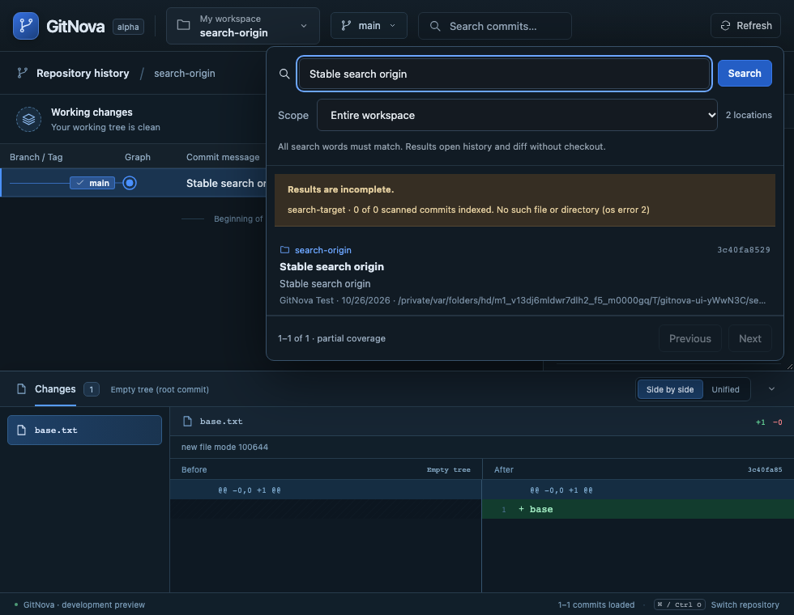

# Milestone 14 — Workspace commit search

Cmd/Ctrl+K opens a transient search in the existing header. Search commit messages, author names, emails and SHAs within the current repository, selected repositories or the entire active workspace. Every search word must match. Results identify their repository and location; choosing one opens its actual graph row, metadata and diff without checking out a branch or changing the Git index. Keyboard navigation, Escape and focus return are supported.

The new Tauri-independent `gitnova-search` crate stores commit metadata once per RepositoryId, sharing it across linked worktrees and retaining immutable entries across scope switches. Reachability remains location-specific. Graph and search now explicitly use `--single-worktree`, preventing an unrelated linked worktree's detached HEAD from silently entering the current graph. Independent repositories, bare repositories and registered submodule memberships keep their own identities.

Opening old history reconstructs the existing lane cursor and displays the relevant 100-row range with a valid continuation. It preserves other repositories' cached graph context. A failed open retains the current graph and search result. Changed refs invalidate pagination; unavailable repositories, shallow histories, oversized objects and index limits produce explicit partial coverage while available repository groups can still return results.

See [ADR 0011](adr/0011-workspace-commit-search.md) for cache/checksum behavior, exact scope, process and memory budgets, consistency boundaries and performance limits. See [surface-budget.md](ux/surface-budget.md) for the new transient control's justification. This increment searches commits; filenames, code, blame and broader archaeology remain deferred. Clone, safe worktree lifecycle, remaining submodule operations and cross-platform/native acceptance are also still open.

## Validation

On macOS, 2026-10-26, the full Rust workspace passed 134 tests. After refining cache retention across search scopes, all 12 real-Git search integration cases passed again. The Tauri mock-runtime command test also passed with new assertions for search/focus argument serialization, real results and remote-origin rejection. Parser tests cover embedded NULs, forged body headers and incomplete/mismatched batch framing. Formatting, strict workspace/all-target Clippy, production frontend build and all 14 frontend unit tests passed.

The search integration cases cover all scopes, workspace boundaries, shared-worktree metadata and detached reachability, persisted-cache corruption/rebuild, ref changes and stale pagination, old graph rows/lanes/continuation, unavailable repositories, hidden recovery roots, shallow/oversized history, replacement-history refusal, Unicode/control text, empty/bare repositories and configured helper nonexecution. All mutating fixtures are temporary real Git repositories.

All 25 browser workflows passed in one complete run (11.3 minutes), including the two new search scenarios: all three scopes, old-history navigation and context preservation; and unavailable-source partial results, failed-navigation context, narrow layout and focus return. Browser tests exercise the actual Rust core through a test-only transport; they do not establish native webview automation or Windows/Linux readiness. The native development app was rebuilt and relaunched after checking that no owned operation lock or pending marker was present.

