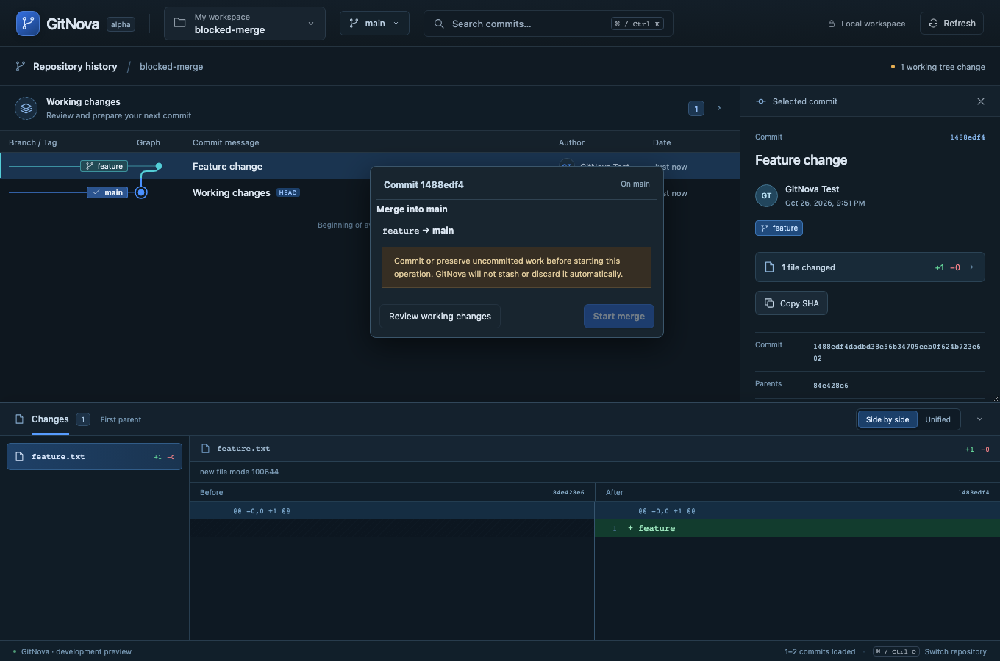
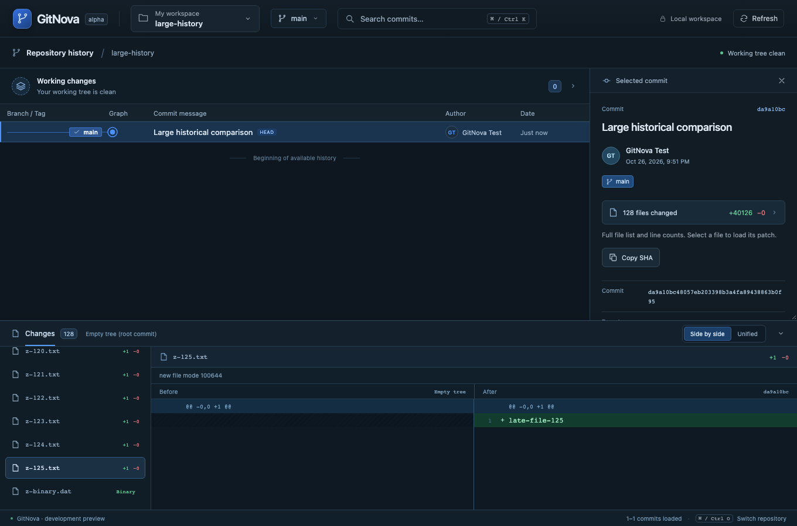
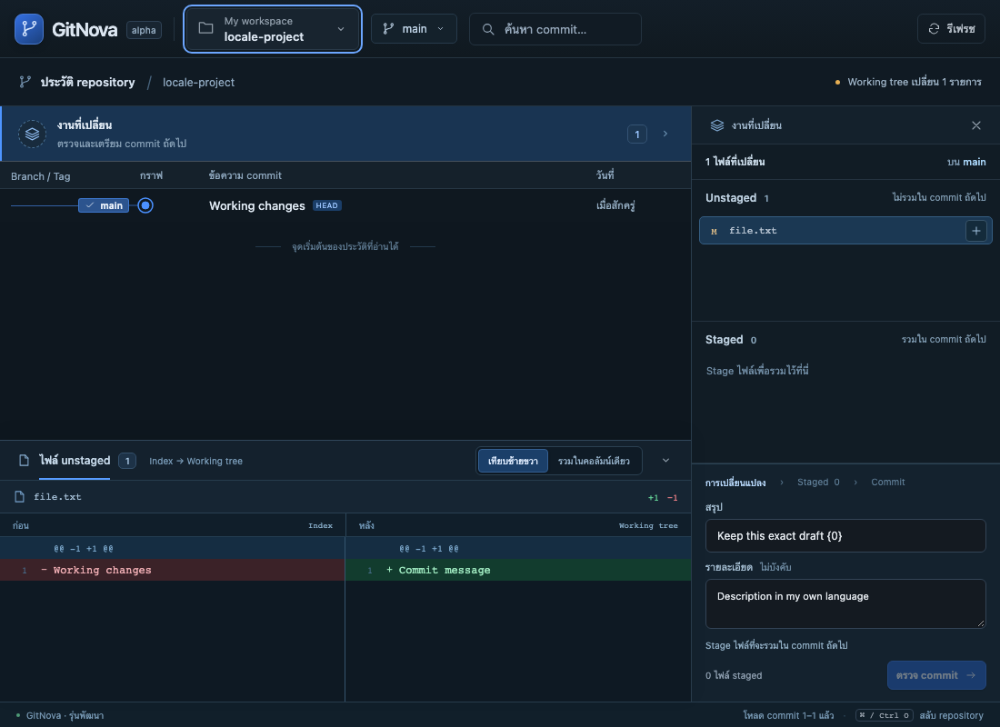
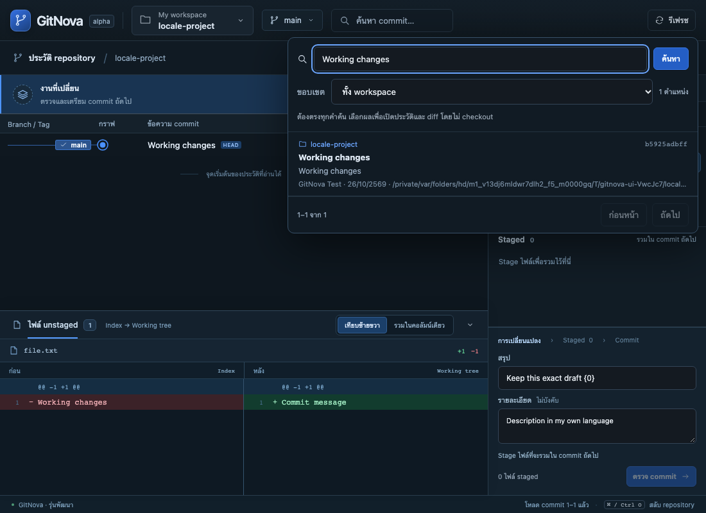
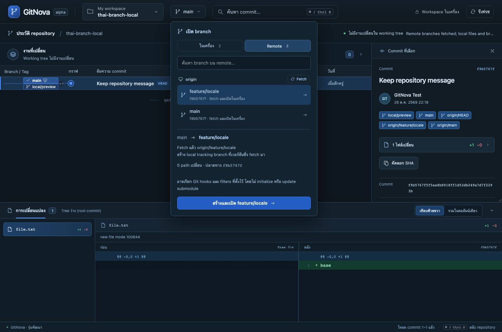

# Milestone 15 — Blocked-merge clarity, large commit files and English/Thai

The screenshot showed intentional protection of one uncommitted working change, alongside two UX problems: a predicted merge outcome was displayed even though preview was blocked, and the historical file count/list came from truncated patch text.

Blocked dirty-state reviews now lead directly to Working changes using the existing control, without showing a computed merge outcome or stashing/discarding work. Historical file counts, additions/deletions and the selectable file list come from complete bounded metadata. Selecting a file beyond the aggregate patch budget loads its exact immutable first-parent comparison into the same dock. A single oversized file can still have incomplete code; its limit is explicit and does not truncate the manifest.

English and Thai are available through Language in the existing workspace picker (Cmd/Ctrl+O). The choice persists locally and updates document language, accessible labels, date display and current workflow text. Switching language preserves repository selection, history context, diff mode and unsent drafts. Repository names, commit messages, paths, authors and code remain untouched. Known GitNova explanations are translated; unknown native diagnostics and Git output retain their original technical text. See [ADR 0012](adr/0012-localization-and-complete-history-files.md) for contracts and limits.

## Validation

New real-Git integration cases pass for a 129-file root commit whose aggregate patch exceeds 512 KiB, exact late-file and quoted-path reads, binary statistics, invalid relative paths, unchanged HEAD/index and first-parent merge comparison despite dirty working files. The Tauri mock-runtime test now exercises historical_patch command arguments/results and remote-origin rejection.

All 17 frontend unit tests pass, including English/Thai catalog parity, placeholder contracts, static source coverage, preference fallback and nonrecursive interpolation. Production build and strict workspace/all-target Clippy pass. The three new browser scenarios pass: blocked merge → working inspector without a misleading prediction; complete large historical manifest → exact late patch; and English/Thai switching/persistence with untouched repository content and commit draft. The full Rust workspace passed 136 tests, including the new IPC checks. The independent complete browser run passed 27 of 28 scenarios; initialize/restore stopped on a stale preview. After the branch-label translations, five targeted scenarios passed, including that submodule case, both remote-opening routes, locale/draft persistence and a new Thai local/remote confirmation case. All 29 distinct browser scenarios therefore have passing coverage across these runs. The submodule test was subsequently tightened to use a non-mutating status inspection between preview and apply; it then passed two consecutive isolated repeats without weakening native revalidation. Tests use temporary real Git repositories; browser transport is emulated into the real Rust core, not native webview automation.

## Read-only test inspection and remaining verification boundary

The initial submodule browser failure reported a changed snapshot before any child checkout. Its test called plain `git status` between preview and confirmation. A temporary real-Git reproduction confirms that clean status can refresh index bytes, whereas `--no-optional-locks status` preserves them. The test now uses that option and asserts unchanged index bytes. This removes a possible self-induced stale token; it does not weaken native revalidation or prove that every external-state race is impossible. Git documents optional status index refresh in its [environment/optional-lock reference](https://git-scm.com/docs/git). Earlier simultaneous Rust/browser execution also caused two wait timeouts; those cases passed in the independent browser run.

The application was rebuilt and relaunched after confirming no owned Git operation lock or pending marker was present. Native webview automation, Windows/Linux execution and performance targets remain unverified.

