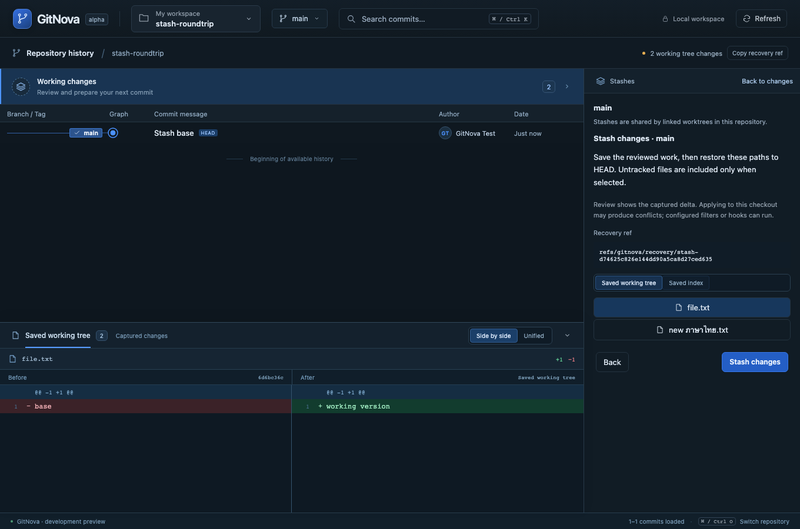
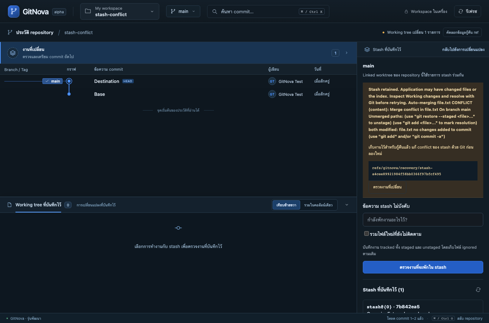

# Milestone 16 — Stash, Apply, Pop and Drop

Working changes now opens Stashes within the existing inspector. Save tracked work with an optional message and explicit inclusion of new files; inspect both the captured working version and staged version in the bottom diff dock. Select a saved entry to Apply, Pop or Drop after review. The commit composer draft remains intact when returning to changes. English and Thai use the existing persisted language preference.

Apply retains the entry and can restore its staging state. Pop removes the exact reviewed entry only after successful application. Drop preserves its object under a recovery ref and saves the original metadata before removing it. Linked worktrees share the underlying repository's stash list. Ordinary history/search excludes the stash pseudo-commit roots.

Real Git fixtures cover mixed staged/unstaged versions, Unicode/untracked paths, stale scopes and positions, conflict retention, native locks, recoverable removal, shared worktrees, packed-ref refusal, hook policy, oversized reviews and ignored-file collisions. A native Git compatibility case exposed untracked cleanup under literal-pathspecs; stash commands now use their own fixed, pathspec-free writer while other writes retain their existing protections.

Stash conflict resolution currently requires Git. Existing merge sessions are not silently reused for stash conflicts. Pop retains saved work on any failed/conflicted application, reports partial outcomes honestly and never force-resets or retries. Pop/Drop support complete loose files-backend stash metadata with at most 200 entries; unsupported layouts/hooks are explicitly blocked. Full limits, lock/publication details and recovery instructions are in [ADR 0013](adr/0013-reviewed-stash-workflows.md).

Validation on macOS, 2026-10-26: the full Rust workspace passed 147 tests, including 10 new real-Git stash cases, a metadata-lock ownership regression and expanded native Tauri command/origin checks. SHA-256 removal and same-size/preserved-timestamp edits are covered. All 17 frontend unit tests, the production build, formatting and strict workspace/all-target Clippy passed. Both targeted real-core browser stash scenarios passed: full capture/Apply/Drop/Pop with saved staging, Unicode untracked files and retained composer draft; and Thai conflict retention/recovery guidance. All 31 browser workflows passed in one complete independent run (13.8 minutes), including the two stash scenarios. After the final metadata permission-preservation adjustment, the shared-worktree removal and lock-ownership regressions were rechecked separately. Tests mutate only temporary real Git repositories; browser transport is emulated into the Rust core. Native webview automation and Windows/Linux execution remain unverified.

