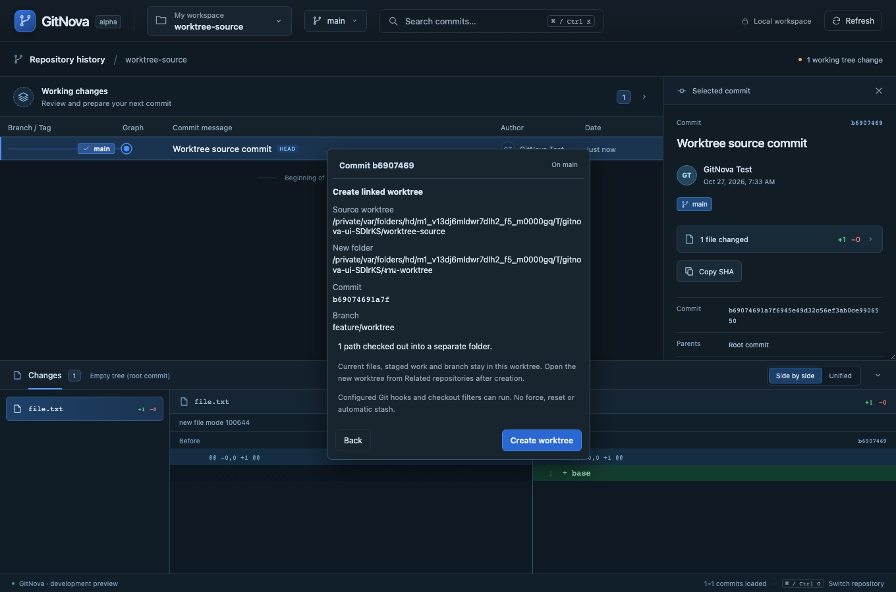
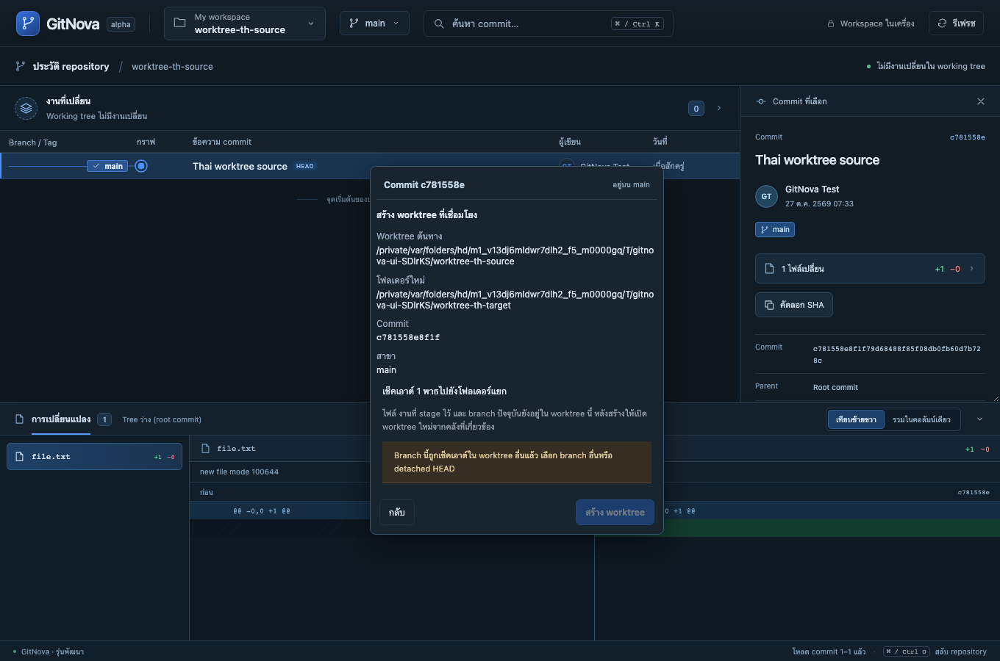

# Milestone 17 — Reviewed linked worktree creation

Right click an exact graph commit and choose Create worktree here. The existing graph popup hosts branch mode, destination and review. Create a fresh branch, use an existing local branch at that commit if it is free, or explicitly choose detached HEAD. The canonical new folder, source worktree, exact commit and complete bounded path count are visible before confirmation. Submodule pointers are disclosed and remain uninitialized.

Source staged/unstaged files, HEAD and composer drafts stay in place. Open the new worktree through Related repositories in the existing workspace selector; registration retains the same RepositoryId and gives the new checkout its own WorktreeId. English and Thai use the existing preference/catalogs.

An existing file/directory/symlink, destination inside another repository or Git metadata, occupied branch, changed parent directory identity, native locks and stale ref/configuration state block confirmation. Preview executes no hooks/filters/network. Confirmed native checkout may run configured hooks/filters. Failures can leave files, a branch or worktree metadata; the durable receipt retains the exact plan and reports partial state without forced cleanup, rollback or retry. See [ADR 0014](adr/0014-reviewed-worktree-creation.md).

This is the creation slice. Safe removal, metadata repair, clone, remaining submodule actions and the broader roadmap remain open. Bare-repository creation, native webview automation and Windows/Linux verification are not established by this milestone.

Validation on macOS, 2026-10-27: the full Rust workspace passed 161 tests, including all 11 worktree creation fixtures and the expanded real Tauri IPC/origin case. Creation coverage includes source index/working preservation, Unicode, linked identity, new/existing/detached modes, occupancy, stale destinations/refs/configuration, native locks, symlinks/replaced parents, invalid paths, broken Git metadata, uninitialized submodule pointers, SHA-256 and hook-induced partial outcomes. Both targeted creation browser flows passed; all 36 browser workflows, including both creation cases, also passed together (see milestone 18). Frontend catalog/unit checks and production compilation pass. All write fixtures use temporary actual Git repositories.

