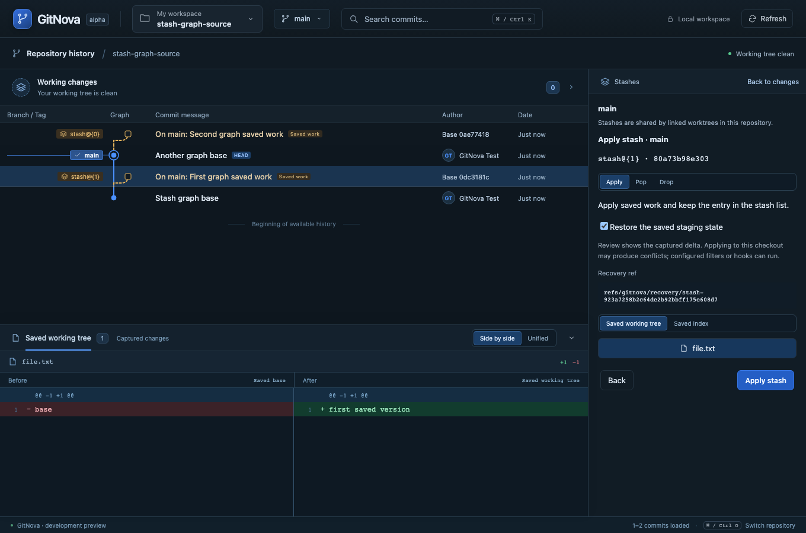
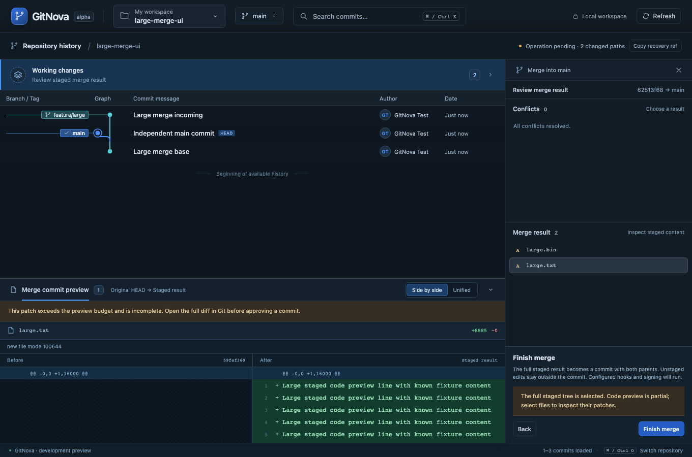
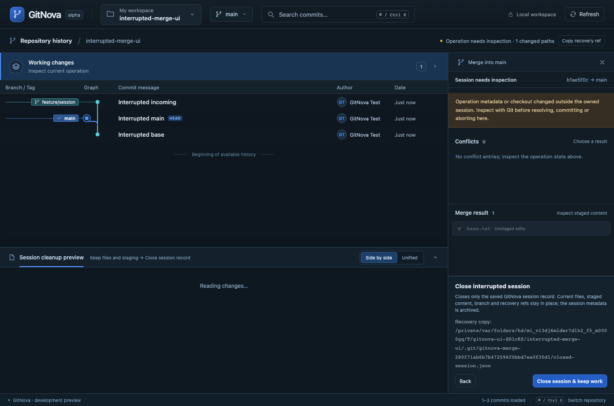

# Milestone 18 — Saved work in the graph and large/interrupted merge recovery

The screenshots exposed three distinct gaps. Stash storage/actions existed, but saved work was invisible in the central graph. Merge inspection reused an in-memory recovery-file limit when only content identity was required. A native Git abort could leave the application-owned session record behind, preventing new writes with no direct return/cleanup flow.

Saved entries now appear as distinct stash rows beside their exact recorded base commit, including older entries from the stash reflog. Unloaded bases are labelled explicitly. Clicking or right clicking a saved row opens the existing stash review/diff; stash nodes never receive normal commit checkout/merge actions. Git's internal stash index/untracked parents remain excluded from commit history/search. Discovery refreshes with repository status and reports failures/200-entry coverage explicitly. Windowing and scroll anchors include the extra rows, and search navigation accounts for their positions.

Merge identity streams file contents with a 2 GiB/20-second aggregate bound instead of loading every file into a 16 MiB buffer. Large binaries are inspectable without text editing. Staged finish reviews bind the exact full tree and complete bounded path scope; code output is independently limited to 512 KiB, labelled when partial, and selected files load their own patches. Native commit postconditions still verify the reviewed tree/parents. Destructive replacement/abort recovery retains the existing 16 MiB per-file, 64 MiB working and 128 MiB combined limits, with an explicit blocker before confirmation.

An active operation now appears as pending or needing inspection even at zero changed paths. Attempting another merge leads back to the current operation through the existing review action. An incomplete owned session can review closure only when HEAD/branch still match its original start and native operation markers/locks are absent. Confirmation archives and removes only the GitNova record, retaining working files, index, branch and both recovery refs. No native abort/reset, automatic cleanup or new commit is performed. This specifically handles an external native abort leaving the app record behind; changed/active foreign checkouts remain protected.

All new product copy supports English and Thai. Worktree creation from milestone 17 remains part of the same graph context. See [ADR 0015](adr/0015-stash-graph-and-large-merge-review.md) for boundaries. The reported developer repository was inspected read-only and its interrupted record was left for explicit review in the app.

The full Rust workspace passed 161 tests, including the large binary/partial-code finish, same-size stale content, interrupted metadata-only closure with exact index/working preservation, stash-base projection and 11 worktree creation cases. All 18 frontend tests, production compilation, formatting and strict workspace/all-target Clippy pass. The three new browser flows passed against the real Rust core in temporary repositories; all 36 browser workflows passed in one complete run (14.7 minutes), including worktree creation, saved-work graph/search, large merge finish and interrupted-session closure. Browser transport is emulated into the real core; Git writes occur only in temporary repositories. The latest macOS native development executable was built and opened after these checks. Native webview automation and Windows/Linux execution remain unverified.

