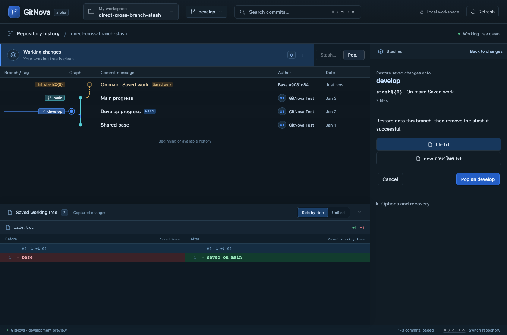
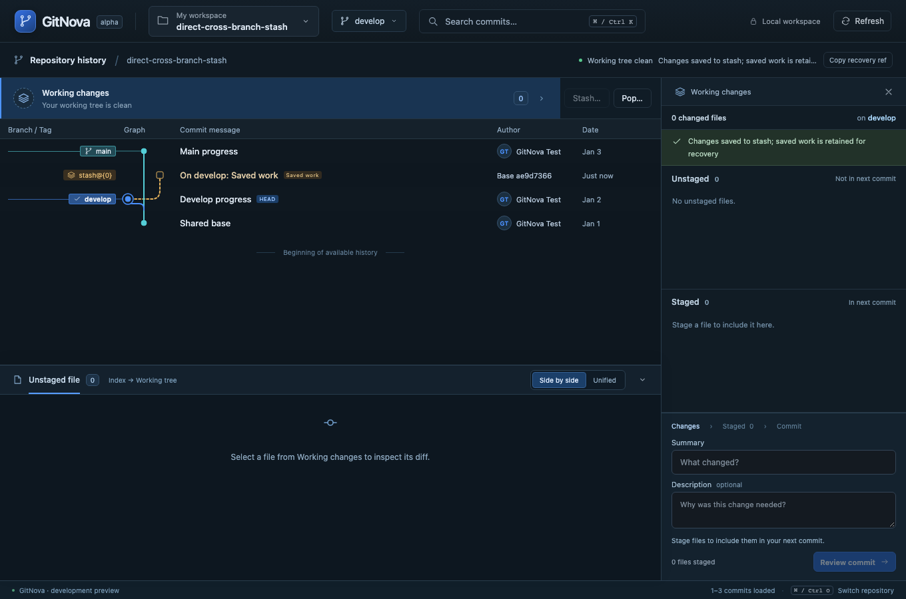

# Milestone 19 — Direct Stash/Pop and separate graph lanes

Stash and Pop now sit beside Working changes in the existing graph. Stash opens a compact review with a branch-specific confirmation; Pop opens the latest saved entry directly for the current branch. Clicking an older graph stash opens that exact entry's Pop review. For example: Stash on main → switch to develop → Pop on develop. Neither branch tip moves and no commit is created.

The primary inspector shows the current destination branch, saved identity/message, file scope and confirmation. Success returns to Working changes with the actual files. Apply-and-retain, saved-index restoration/comparison, recoverable deletion and recovery metadata live under Options and recovery. Default Pop restores working content without --index; restoring the saved staging state remains explicit. Stash includes new nonignored files by default. Changing its optional message/file inclusion requires reviewing the updated scope before writing. The original full message remains in details/tooltips; GitNova's generated UUID suffix is hidden in the human title.

Stash glyphs use reserved lanes beyond all real Git nodes/strokes/edges. Co-located stashes use distinct lanes, continuing separately to their actual base. This fixes the screenshot where the saved-work glyph borrowed the neighboring main branch lane. Existing commit lanes are unchanged. Captured diff labels remain distinct from a prediction of the target's merged file contents.

Blocked operations lead to Working changes. Conflict outcomes survive returning to the inspector; saved work remains retained for Git resolution. If native metadata prevents Pop removal, an explicit Restore and keep stash alternative retains supported Apply behavior without an automatic write or retry.

See [ADR 0016](adr/0016-direct-stash-pop-and-reserved-graph-lanes.md). English and Thai use the existing catalogs. All writes in validation use temporary actual Git repositories; the developer's stash/branch contents are not changed by tests.

Validation on macOS, 2026-10-27: all 12 real-Git stash integration cases passed, including main-to-develop Pop with unchanged tips and unstaged restored content. All 20 frontend unit/catalog tests passed, including neighboring-lane and multiple-entry geometry. The 12 affected browser workflows passed together (6.0 minutes): graph/diff, local and remote checkout, cached position, search, English/Thai, advanced stash staging/draft retention, conflict retention and the direct cross-branch cycle. A separate packed-metadata Apply-and-retain browser case also passed (20.5 seconds), for 13 browser scenarios verified in this milestone. Production compilation, formatting and strict workspace/all-target Clippy pass. Browser transport uses the real Rust core; the native development UI receives the updated frontend. Native webview automation and Windows/Linux execution remain unverified.

