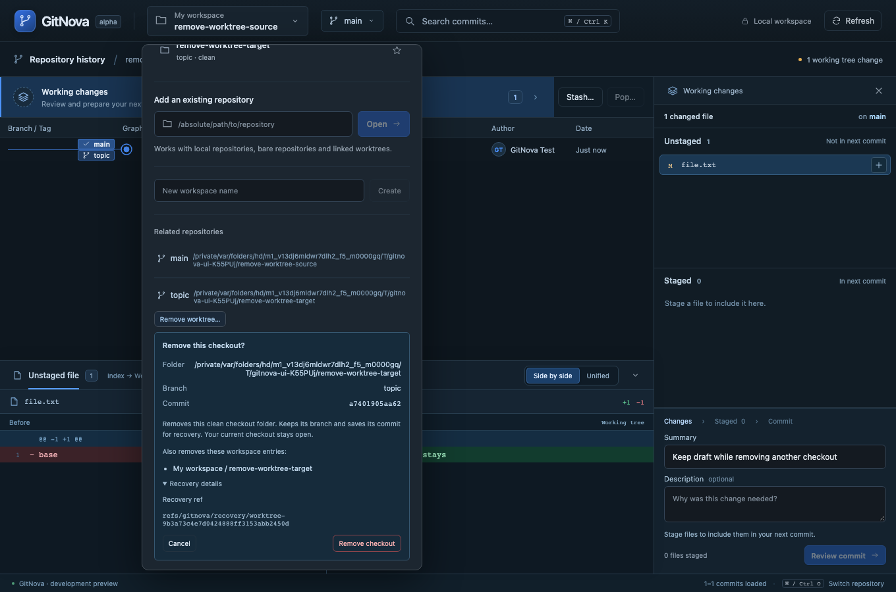
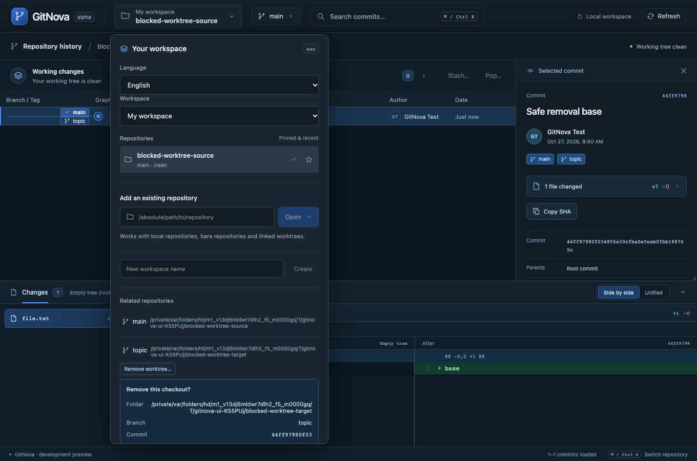
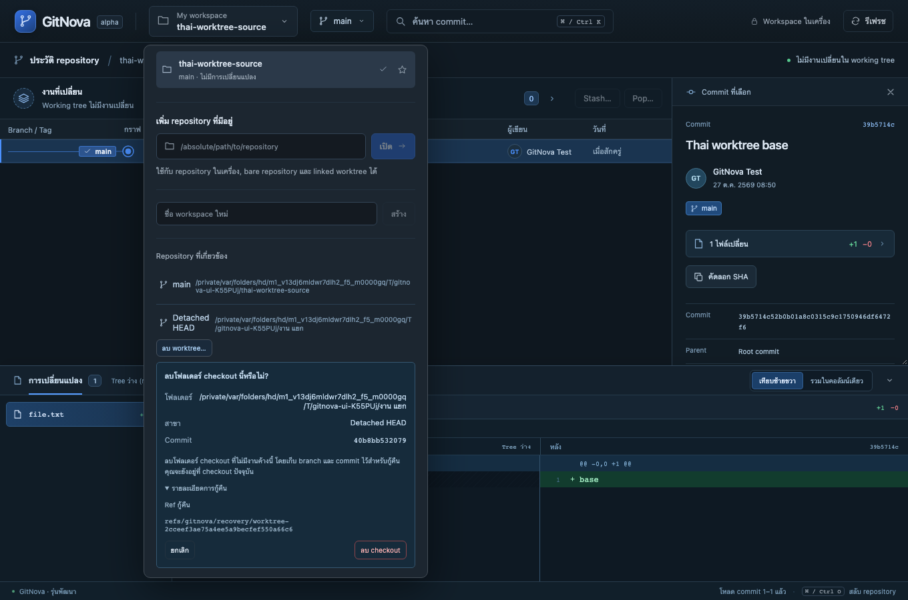

# Milestone 20 — Safe removal of a linked worktree

The existing workspace picker’s Related repositories row now offers **Remove worktree…** for another linked checkout. Open remains the normal row action. Inline review names the exact folder, branch or detached HEAD, commit and workspace entries affected. Cancel changes nothing; **Remove checkout** confirms only that scope. Recovery metadata remains under optional details. Current and main checkouts do not display a removal action, and native validation independently protects both.

Removal requires a clean available worktree sharing the registered Git common directory. Staged, unstaged, untracked and ignored work, hidden/sparse index entries, submodule gitlinks, native locks, pending operations, symlink/replaced/missing folders and locked/prunable worktrees are refused. A fresh disposable index rehashes tracked content without trusting the real index’s stat cache or changing that index. Directory identities, Git state, configuration, refs and affected workspace memberships bind the confirmation; changed evidence requires review again.

Execution holds exclusive native HEAD/index/branch guards, pins the exact commit in a recovery ref, checks the target again, and calls native non-forced `git worktree remove`. The branch remains. Detached and unpublished commits remain reachable through recovery. The application does not recursively delete a folder itself. Lock guards remove only their own content, protecting a later owner if native removal deletes and recreates metadata.

After verified native success, core removes only reviewed memberships across workspaces and retires the WorktreeId. Recreating a checkout in that folder receives a new ID; RepositoryId and other checkouts remain intact. Native removal and catalog/receipt publication are separate effects. Publication failure reports an uncertain/partial result with the reviewed plan and recovery pointer; there is no automatic retry or rollback. Source graph selection and commit drafts remain open.

Both English and Thai use the existing catalogs. See [ADR 0017](adr/0017-reviewed-worktree-removal.md). This completes clean linked-checkout creation/open/removal, not worktree repair, unlock, prune or removal of submodule-containing checkouts. Files ref storage and an available source checkout are required. External file writers remain outside an atomic transaction. Windows/Linux execution and native webview automation remain unverified.

## Verification

All write fixtures use temporary real Git repositories, never the developer’s registered repositories. Backend coverage includes named and detached/unpublished removal, SHA-256 identity, cleanup in multiple workspaces, new checkout identity, source index/staged/working preservation, ignored/nested data, hidden flags, stat-cache-spoofed edits, native and worktree locks, pending operations, same-Gitdir folder replacement, symlinks, stale refs/memberships, configured reference-hook edits after recovery pinning, and catalog publication failure. Native IPC verifies typed commands and rejection of remote origins. Browser transport uses the real Rust core; it does not certify native webview transport.

Validation on Apple Silicon macOS, 2026-10-27: the full locked workspace Rust run passed **175 tests**, including the native command/origin test and removal guard ownership. The final removal integration suite passed **13 tests**, including the additional same-Gitdir/replaced-folder case and a stat-cache fixture that proves ordinary Git status misses the modified bytes. All **20 frontend tests**, production TypeScript/Vite compilation, formatting and strict workspace/all-target Clippy passed. Five browser scenarios were verified: the three new removal workflows passed together (1.8 minutes), existing English/Thai draft preservation passed, and existing graph worktree creation/opening passed separately (16.5 seconds). Browser startup waits were corrected to await repository loading; the existing creation receipt assertion now permits its asynchronous write/refresh to finish under concurrent regression load. Screenshots below come from the final removal run. Native development backend was rebuilt for the new commands; no fixture writes touched registered developer repositories.

