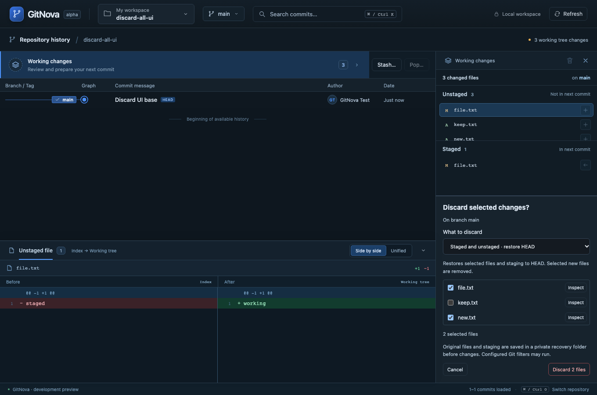
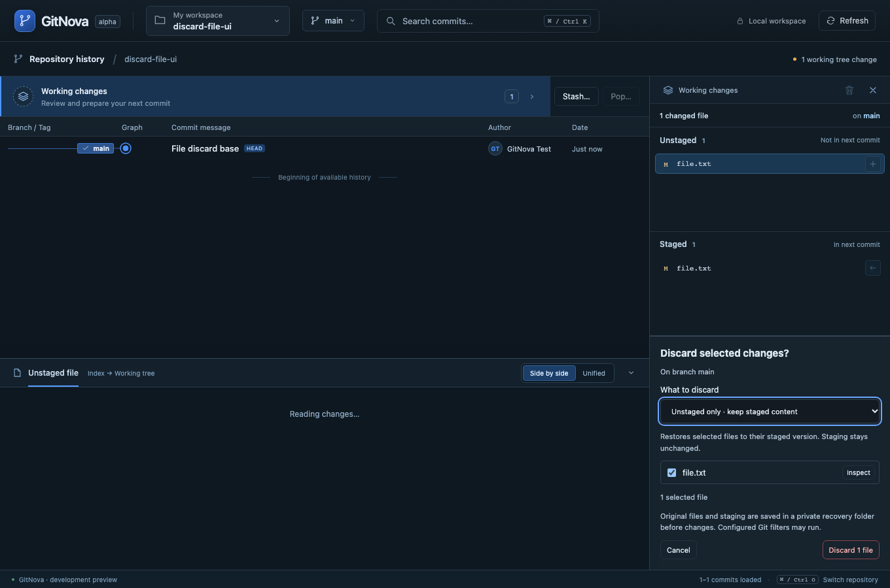
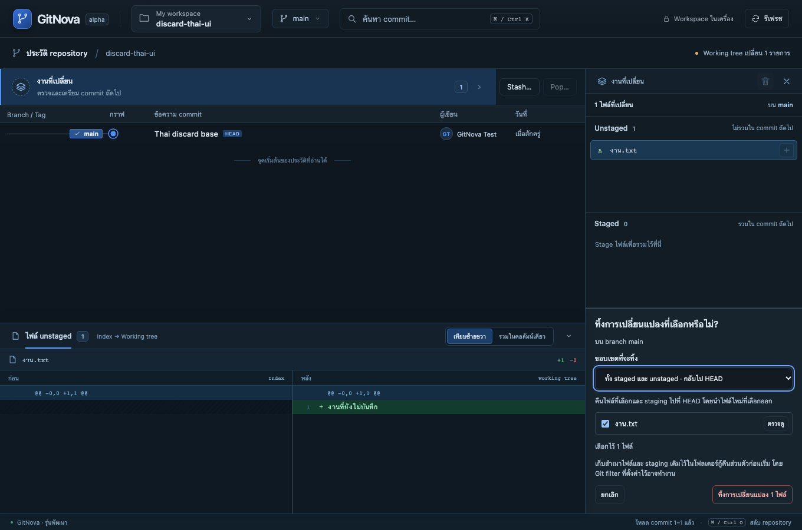
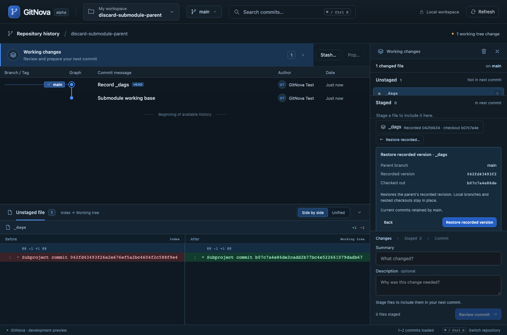

# Milestone 21 — Reviewed Discard and direct submodule restore

Working changes now has one trash action for a selected/all-file review and a contextual **Discard file…** action on right click or Shift+F10. Reuse the same inspector and diff dock. Select exact paths, choose **Unstaged only** (restore from the index, preserving staging) or **Staged and unstaged** (restore selected paths and their index entries from HEAD), inspect and explicitly confirm. An unborn repository uses the empty-tree scope. Cancel and completion preserve the commit draft and graph context; unrelated files and HEAD are not selected for change.

Selection/scope changes disable confirmation immediately until the matching preview arrives. Delayed responses cannot authorize the previously selected files under the new displayed count. Actual file bytes, selected staged blobs, index, HEAD, attributes, configuration and directory identity bind the native preview. Hidden/sparse index entries, conflicts, directories, nested repositories and submodule pointers are refused. New selected nonignored leaf files can be removed; ignored files and directories are never swept by a recursive clean.

Before writes, save private raw working files or symlink targets, selected staged blobs, exact original index, path/kind/mode/hash metadata and a complete manifest. Recovery lives under the shared common Git directory, retaining the originating checkout identity so that later linked-worktree removal cannot delete it. **Copy recovery location** opens the path for inspection/copying. The application does not yet provide automatic recovery/Undo UI or retention cleanup. Do not blindly replace a current index with the saved index: inspect newer work first, and account for split-index dependencies if applicable. Raw selected staged blobs and entries are saved separately for inspection/reconstruction.

Confirmed discard holds the common operation guard and exclusive native index/HEAD/branch locks. Native restore uses a prepared temporary index and literal selected paths, with recursive submodule updates and implicit Git transports disabled. Unstaged-only leaves the real index byte-for-byte unchanged; all-content publishes the prepared selected-path index after validation. Empty-index/untracked-only discard does not create an index. Configured checkout filters may run only after confirmation; previews never execute them. Partial errors retain recovery and report uncertainty without automatic rollback/retry. External editors remain outside an atomic transaction.

## The `_dags` screenshot

A gitlink was being sent through ordinary-file fingerprinting, which rejected its directory before the real Git pointer diff could display. Gitlinks now have inspection-only previews, keeping their mutation guard. The existing SubmoduleEntry is reused directly in Working changes, showing recorded INDEX, checked-out and parent HEAD pointers and a separately reviewed **Restore recorded…** action. Dirty child files lead to opening the child’s graph/Working changes for their own review/discard. Parent discard never recursively resets the child. Pointer restore preserves the parent index and child branch tips.

## Limits and recovery contents

Maximum 2,000 selected paths, 16 MiB per file/blob, 64 MiB working data and 128 MiB combined original-index/selected raw recovery. Content is hashed directly rather than expanded into JSON byte arrays. The recovery manifest identifies the request and source checkout; files.json maps native path, kind, mode and hashes to work-N and staged-N raw data. Symlink work-N contains its NativePath target representation rather than dereferenced external content. Index is the original raw index, not a patch. Recovery directories and files use private permissions on Unix and are synced before checkout begins.

See [ADR 0018](adr/0018-reviewed-discard.md). English/Thai strings use the existing catalogs; repository names, paths, commits and drafts remain original. All writes in verification use temporary real repositories. Windows/Linux behavior and automated native webview interaction remain unverified.

## Verification — 2026-10-27

Final targeted verification passed after resuming with bounded workloads:

- 14 real-Git discard integration cases, including empty/unborn indexes, binary/new/deleted/literal paths, symlink protection, CRLF checkout, stale content/config/attributes, hidden/submodule refusal, recovery-storage failure, configured-filter failure, and recovery surviving linked-worktree removal.
- One lock-ownership unit test and one native Tauri command/origin test, including rejection of remote-origin discard.
- All 20 frontend unit/catalog tests and production TypeScript/Vite compilation.
- Four browser scenarios passed together (1.9 minutes): selected/all-file discard with cancellation/draft retention, single-file unstaged discard and stale rejection, Thai discard, and direct submodule recorded restore with unchanged parent staging and retained child branch. Delayed preview responses are exercised when the selected file set changes.
- Formatting, strict Clippy for the changed core/Git libraries, and the updated native desktop debug build passed.

Checks ran sequentially with one compiler job and one Rust test thread; browser execution used one worker and now serializes real-core bridge requests, tracking queued requests through cleanup. This avoids spawning multiple core processes for simultaneous UI reads. The repository's default compilation cap is two jobs. The full workspace/browser suites were not rerun for this slice. Native GUI automation and Windows/Linux execution remain unverified.

An earlier attempt was blocked by executable-launch stalls after a machine restart; its incomplete checks were not treated as passes. See the separate [machine-freeze investigation](diagnostics/2026-10-27-machine-freeze.txt). The successful targeted run does not establish the cause of the earlier system freezes. No security-agent policy or developer repository contents were changed. The native app was built without leaving its polling process running during verification.

