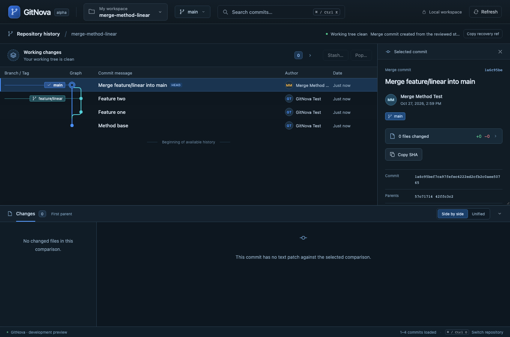

# Milestone 29 — Explicit merge method and actual graph topology

The supplied GitNova screenshots show a reviewed fast-forward followed by co-located main/feature refs on a linear history. A separate merge-commit operation produces a two-parent commit, while a fast-forward advances a branch without adding one. These are different valid operations, not evidence by themselves of an incorrect graph renderer. GitNova's usability defect was offering automatic fast-forward under its single Merge action without an explicit merge-commit choice.

Reuse the graph action preview for a Merge method selector. It avoids another screen, dialog, sidebar or context-menu action. Default Merge to Create merge commit. Fast-forward only remains available in that same review and explains its linear result and divergence refusal. Changing methods clears the preview and requires a fresh native review; an older native backend that does not echo the selected method is rejected.

The domain request adds a camelCase `method` enum: `auto`, `mergeCommit`, `fastForwardOnly`. Missing values deserialize as legacy auto so old session markers, receipts/fixtures and non-UI callers stay readable. The new UI explicitly sends mergeCommit by default; cherry-pick/revert send auto and reject merge-only policies. The request is part of the existing preview token and owned marker. Method substitution cannot reuse an old token. Invalid enum values are rejected by deserialization.

For a descendant source, mergeCommit predicts the source tree but prepares native `--no-ff --no-commit`, keeps HEAD unchanged until reviewed finish, then verifies both parents and the expected staged tree through the existing finish flow. FastForwardOnly uses `--ff-only`, creates no commit and refuses diverged histories. Already-included history remains an explicit no-op blocker. Pull/tracking branch fast-forward workflows are unchanged.

Graph rendering continues to use actual commit parents. A new merge commit has two outgoing edges and a feature lane; fast-forward produces no artificial node. Existing source history is never rewritten merely to change appearance. See the [Git merge manual](https://git-scm.com/docs/git-merge) for `--ff`, `--no-ff` and `--ff-only` semantics.

The related zero-file pending-state guidance is also refined: a legitimate no-ff merge can have zero net file changes while still needing to record both parents. Keep reviewed Finish primary in that case. Prefer abort review after a known Discard result (or an empty single-commit operation that cannot finish), without automatically ending any operation. The browser fixture deliberately changes a file and changes it back on the feature branch to verify this distinction. Successful fast-forward feedback explicitly states that no merge commit was created.

Tests use temporary real Git repositories. They cover descendant no-ff start/finish and exact parent order, branch tips and graph edges, explicit fast-forward, method/token substitution, divergence refusal, already-included history, and rejection of merge policies for cherry-pick/revert. Browser coverage changes methods in one preview, confirms no write during choice/review, finishes a real two-parent commit and checks its rendered junction. Existing conflict/abort/fast-forward and patch-operation coverage is retained.

## Verification

Across serial targeted runs, 22 unique merge cases passed: the twenty existing regressions and two new explicit-policy cases. The explicit fast-forward/legacy-deserialization/feedback case was also rerun successfully. Four focused patch-operation cases passed: cherry-pick authorship/single parent, conflicted cherry-pick resolution, merge-mainline delta selection and inverse revert without rewriting source history.

Frontend/catalog units: 23 passed; TypeScript passed. Three one-worker browser workflows passed in 2.8 minutes: reviewed abort plus explicit fast-forward, the prior discard/abort/Pop flow with EN/TH, and linear-history method selection followed by a real zero-file/two-parent merge and rendered junction. Native Tauri command integration passed, including round-trip echo of all three method values, invalid-method refusal and remote-origin rejection. Formatting and strict focused core/Git Clippy with all targets passed. All write fixtures were temporary real repositories; no user repository history was modified.

Local bundle: **GitNova Updated.app**, 61.61 MiB. Production frontend build/type-check, signature verification and embedded UI self-check passed. The running GitNova.app was retained. Quit it after any running command finishes, then open the updated bundle; single-instance behavior otherwise focuses the old process.
