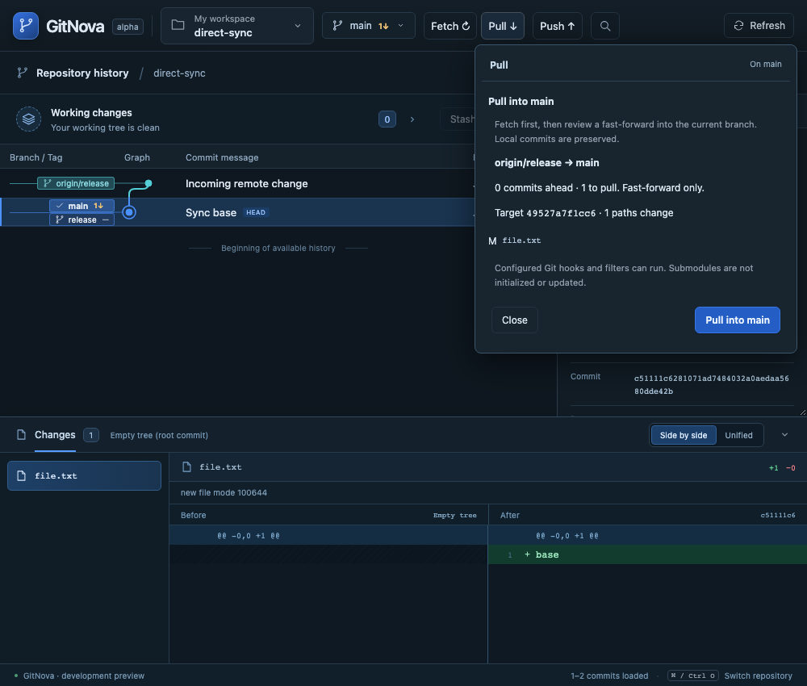

# Milestone 31 — Fetch and Pull beside Push

The graph header now offers Fetch, Pull and Push. The existing graph menu also offers Fetch and Pull into the current local branch. These entries reuse the graph action popover; the remote picker and its existing fetch/open flow remain available. [ADR 0026](adr/0026-direct-fetch-pull.md) records the interaction rationale.

Fetch selects the current branch's configured fetch remote, or the only configured remote. With several remotes and no matching upstream, it asks for an explicit choice. It updates remote-tracking refs without moving local branches or working files. Loading states identify remote reads, Fetch and pull preparation; no fabricated percentages are shown.

Pull resolves the current branch's actual remote/upstream in native Git, fetches that exact branch, then shows the destination local branch, incoming/ahead counts, target revision, affected paths and blockers. Confirmation performs only a validated fast-forward. For example, `main` following `origin/release` updates `main`; an unrelated local `release` is preserved. Cancellation leaves the fetched metadata available and the checkout untouched. No upstream means a clear configuration error; dirty work, divergence, pending operations and stale state retain existing protections. Submodule checkouts are not recursively updated. Hooks and filters may run at confirmed integration.

The native helper generalizes existing remote checkout validation while preserving the old remote-open API. Current-branch Pull has separate typed source/preview/apply commands; it cannot create a different local branch or silently change upstream. Native execution re-resolves the live branch/upstream and compares the reviewed token. Fetch and local integration are separate effects, not an atomic transaction. Failures require inspection and are never retried automatically.

At smaller desktop sizes, search retains its keyboard shortcut and accessible button while showing an icon to leave room for Git actions. All added UI strings have English and Thai catalog entries.

Validation passed in temporary real repositories: 8 existing remote regressions, 2 current-branch Pull cases (different upstream name, changed-upstream token rejection, dirty work, divergence and missing upstream), 26 frontend unit cases, 4 browser scenarios covering Fetch/Pull and Push regressions, and 1 native IPC case including remote-origin rejection. Browser review cancellation preserves HEAD, confirmed Pull preserves an unrelated same-name local branch, Fetch preserves dirty files, and the 1,000-pixel header fits without horizontal overflow. No developer work repository is fetched or pulled during verification.

