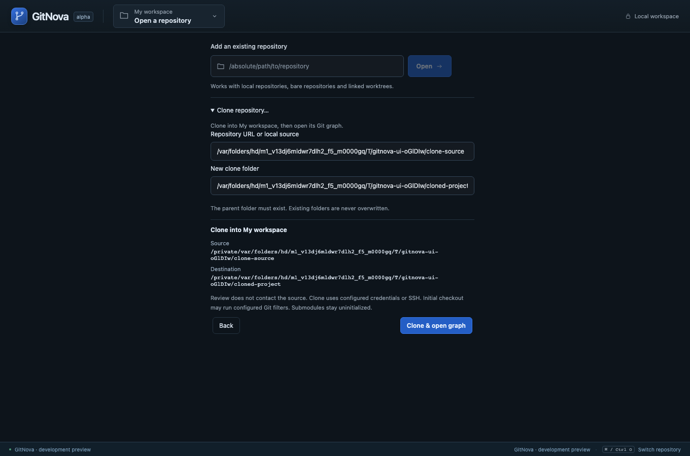

# Milestone 32 — Clone into a workspace

This is the first slice of [the user's feature-first priorities](delivery-priorities.md). Clone is available next to Add existing in the existing workspace picker and empty-workspace form. Enter a standard Git URL or absolute local source and an absent absolute destination, review the resolved source, canonical destination and named workspace, then confirm Clone & open graph. Existing folders are refused even when empty. No separate screen or dashboard is introduced; see [ADR 0027](adr/0027-clone-into-workspace.md).

Preview performs only local/configuration reads. Execution uses native Git with standard transports, configured credentials/SSH, an empty hook/template directory, no recursive submodules and independent objects rather than local hardlinks/alternates. Initial checkout may run configured filters. The Git worker has bounded output, one pack/index thread and a ten-minute execution budget. The UI shows actual phase events with an indeterminate progress indicator; it does not invent a transfer percentage.

Clone and catalog registration are separate effects. Native registration targets the reviewed workspace rather than whichever workspace happens to be active when transfer completes. A journal records pending, cloned, failed and successful attempts under `operations/clones`. The existing Clone area can inspect the latest bounded attempt summaries after restart. Failed/incomplete destinations are never automatically removed, opened or retried. A cloned-but-unregistered repository remains available for manual inspection and Add existing. Initial catalog creation now persists a stable workspace identity without replacing a file created concurrently; corrupt catalogs still fail without replacement.

Drafts survive closing/reopening the workspace picker. During a confirmed clone, closing that picker by Escape/outside click is blocked so loading and outcome remain visible. The empty-workspace welcome condenses its decorative introduction during cloning and scrolls at smaller heights so the confirmation is accessible. EN/TH catalogs cover the new labels and fixed diagnostics; Git's technical output stays original.

Validation: 5 clone core cases, 16 existing real-Git integration cases, 2 storage cases, 26 frontend unit cases, 3 browser scenarios and 1 native IPC case passed. Coverage includes real commit/upstream/graph integration, empty repositories, uninitialized submodules, source-independent objects, existing/dangling destinations, stale reviews, requested workspace selection, concurrent initial catalog creation, restart journals, preserved drafts, actual progress events and remote-origin rejection. All clone operations use temporary local repositories; no developer repository is cloned or modified as a fixture.

TypeScript, Rust formatting and strict Clippy checks for the affected core/Git/storage/IPC targets also passed. Verification ran one runner at a time.

Large network clones, actual process termination during transfer, native interactive WebView automation, Windows/Linux behavior and long-session memory/latency measurement remain unverified. There is no clone cancellation/resume UI or recursive/bare-target option in this slice. Rebase, Amend, hunk operations and the remaining submodule/worktree capabilities are still outstanding. The full feature plan and later performance/recovery workstreams are not complete.

