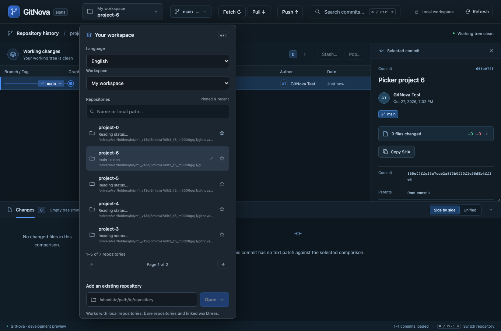

# Milestone 33 — Five-repository pages and local repository search

The existing workspace picker now shows at most five registered repositories per page. Search matches repository name and registered local path across the entire current workspace before pagination, with case-insensitive Unicode-normalized matching. It does not crawl the disk or discover unregistered repositories. No additional screen or navigation panel is introduced.

Pinned entries retain priority; equal pin states keep native recent order. All pinned entries share the same five-row page limit. The selected repository's page opens by default, query changes return to the first page, and pinning returns to the first page without switching repositories. Previous/next, page/result counts, clear search and an explicit no-match state remain beside the existing list. Local paths distinguish identical folder names. Language changes retain the current query and page.

Picker status requests are limited to visible entries, with two workers and cancellation of obsolete queued work. A matching current graph status can be reused; the active graph continues its own normal refresh. Only visible row statuses are retained, and filtering uses existing catalog metadata without new disk/index scans. Development StrictMode does not start duplicate workers from its discarded mount. Add existing, Clone and per-repository graph context remain available in their existing positions.

Validation: 26 frontend unit cases and 3 real-core browser scenarios passed. Browser fixtures use seven real temporary repositories to verify the five-row bound, cross-page name/path search, empty results/clear, pin priority, selection through search, visible-only status requests, opening a selected repository beyond page one, EN/TH state retention and existing keyboard/workspace/graph behavior. TypeScript validation passed. No Git backend behavior changed, so broad native suites were not repeated for this UI slice.

