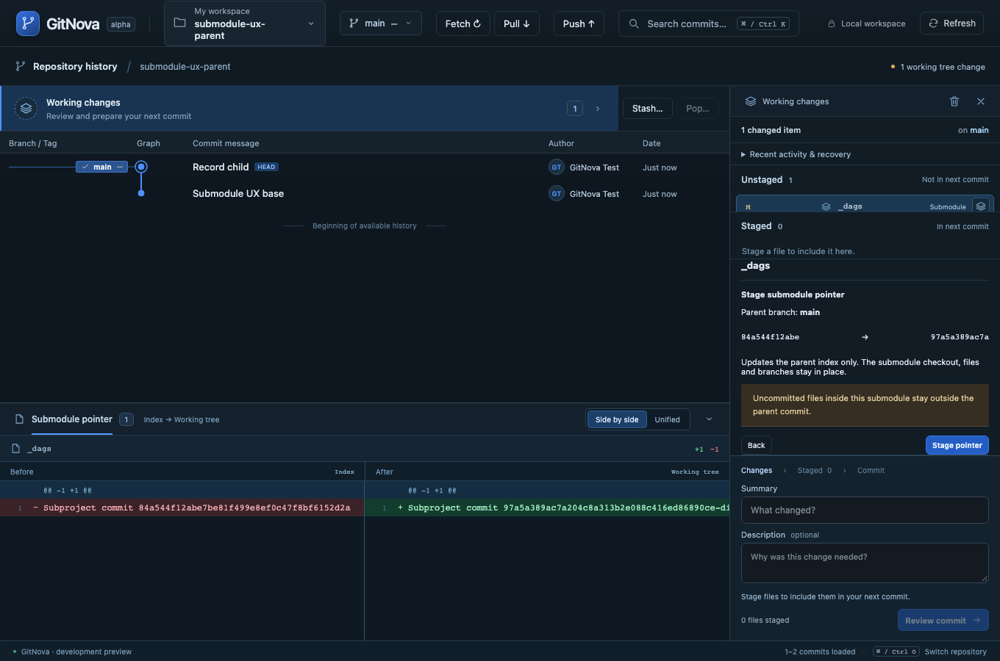

# Milestone 34 — Clear submodule files and pointer workflow

The user clarified that submodules were confusing rather than identifying one failed command. Working changes now labels a submodule as an item with its own icon and separates three revisions: parent commit, parent index and child checkout. Commit changed, Pointer staged and Uncommitted changes inside are distinct states. Open submodule is the primary action for dirty child files; it opens the child graph and its normal Working changes. Double-clicking the row does the same. Parent counts describe changed items, not files inside child repositories.

Stage pointer and Unstage pointer are explicit reviews in the existing submodule area and row context menu. Review shows the exact SHA transition and that uncommitted child files remain outside the parent commit. The summary yields its existing space to the active review rather than stacking another panel. When only child files are dirty and the checkout equals the index pointer, the selected row action opens the child instead of offering ineffective file staging. Restore recorded stays separate and retains its dirty/unpushed-work protections. [ADR 0028](adr/0028-submodule-pointer-workflow.md) explains the scope and placement.

Native pointer updates verify the discovered direct submodule, parent HEAD/index, stage-zero mode 160000, child identity/HEAD/status and ordinary index flags. Existing parent operation/index guards protect preparation. The new index is prepared with exact NUL-delimited index-info input and offline Git; no recursive add, checkout, child commit, hook, filter or custom update command is used for staging. A complete original parent index is persisted before atomically installing the prepared index. Its location is recorded in the durable operation receipt. Stale state, conflicts, hidden flags and pending operations stop the operation. These checks do not claim a transaction against arbitrary external filesystem/Git edits.

Complete parent commit review now accepts existing gitlink modifications while preserving generic addition/removal/type-change/conflict blockers. A parent commit records the staged child commit only; dirty child files and child branches/index/checkout remain untouched. Native push still checks submodule availability rather than publishing child commits implicitly. Adding/removing submodules and nested pointer ownership outside the current parent retain their separate workflows. Pointer staging/commit does not implement those remaining roadmap items.

Validation passed: 14 submodule core cases (11 existing plus 3 new), 15 everyday-write regressions, 26 frontend unit cases, 4 real-core browser scenarios and 1 native IPC case, all with one runner at a time. New cases verify stage/unstage/parent commit with dirty and untracked child files, byte-preserved child index, retained child refs, original parent index recovery, stale child/parent snapshots, external locks, pending operations, hidden flags and dirty-only/no-new-commit states. UI tests cover explicit review/cancel, context-menu actions, child navigation, parent commit and unchanged Initialize/Restore behavior. Native IPC covers successful pointer stage/unstage and rejection of remote web origins. Tests write only temporary real repositories.

The usual sequence is: commit files inside the submodule → return to parent → Stage pointer → commit the parent. Staging an already existing child commit while leaving later child edits uncommitted is also supported and explicitly scoped. Broader long-session speed/RAM and crash-injection audits remain in the agreed later workstreams.

