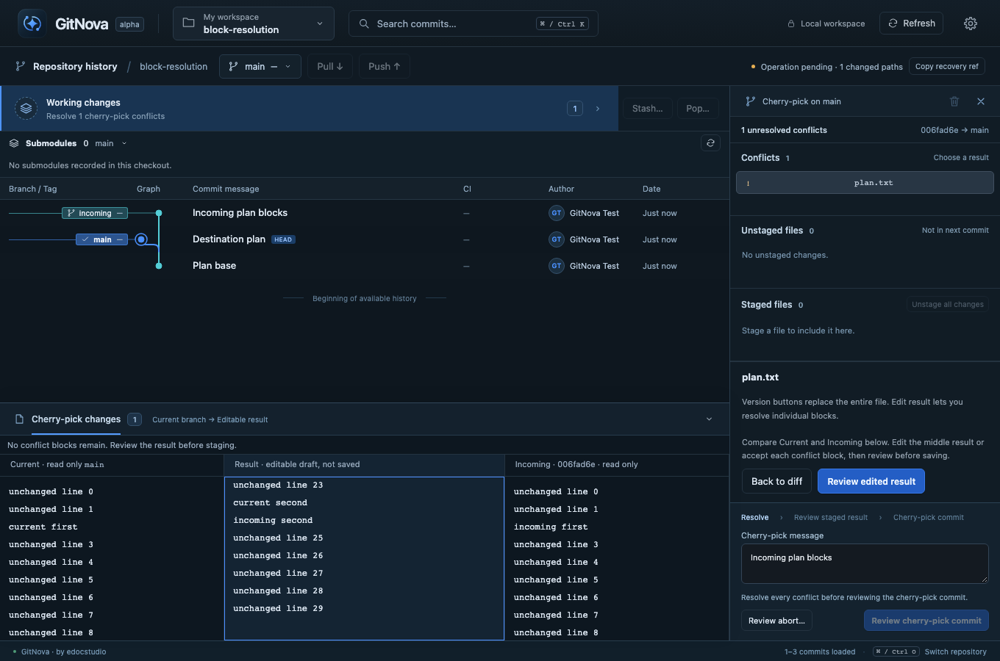

# M51 — Three-way conflict resolution in the graph diff dock

The existing merge/cherry-pick/revert inspector could resolve a whole file or edit a result, but the incoming version was hidden. Selecting a supported text conflict now displays Current | Result | Incoming in the existing bottom dock. The sources come from actual index stages 2 and 3, not from an assumed branch-tip file. Reverts label their incoming side as the pre-commit version. A missing stage is explicitly shown as deletion; unavailable binary/oversized text is never presented as an empty version.

The result starts read-only. Edit result enables a draft in the middle column, preserving the established review/apply workflow. Previous/Next conflict navigates complete Git marker groups. Accept current, incoming or both changes only the selected block in memory and preserves surrounding text and line endings. Both means current then incoming; diff3/zdiff3 ancestor text is excluded. Malformed/nested groups are not offered as automatic choices. Manual editing remains available and the native resolver still refuses unresolved markers and over-budget results.

Whole-file version buttons remain in the inspector and now explain their scope. Block actions never stage immediately. Review edited result displays working-file-to-proposed-result changes; Apply resolution saves with recovery evidence and stages the selected path. The user then reviews and finishes the merge, cherry-pick or revert separately. Unrelated staged content, authorship rules and parent topology retain their existing behavior.

Editor drafts survive returning from preview and revisiting unchanged files within the inspector. Before proposing a resolution, refresh and compare the displayed conflict versions/working content; external changes block review and leave the current draft visible. Native apply also revalidates the action token and refuses stale working/index state. No automatic retries, external operation adoption or unreviewed overwrites are introduced.

## Scope and limits

Text versions and result drafts remain bounded to the existing 512 KiB content preview budget. Symlink, gitlink, binary and oversized conflicts retain supported whole-version selection or explicit external inspection. Operations started outside GitNova remain inspectable and require native Git recovery; this milestone does not adopt them or add stash conflict writes. The editor does not infer semantic correctness from a conflict-free result.

## Verification

Git writes use disposable repositories exclusively. Targeted native merge tests cover exact stage-2/stage-3 text, missing-stage deletion, binary refusal, stale resolutions, staged recovery, finish/abort and parent correctness. Frontend tests cover independent block choices, CRLF/custom-width diff3 markers, malformed/nested groups and stale block descriptors. Browser checks exercise merge editing, cherry-pick/revert resolution, per-block current/both choices with no disk/index writes before confirmation, and external editing while a draft is open. Final check and packaging results are recorded below after execution.

### Results

- Native merge/recovery integration: **22 passed** (one test thread).
- Frontend units/catalogs: **37 passed**, including five conflict-parser cases; TypeScript passed.
- Strict Git/core/desktop Clippy across all targets and Rust formatting passed.
- Real-core browser transport: **4 passed** (one worker): manual merge editor through two-parent finish; incoming cherry-pick resolution and inverse revert; diff3 multi-block current/both resolution through single-parent finish; and refusal of an external edit with the draft retained visibly. The browser transport does not certify native WebView interaction.

The screenshot uses a real disposable repository with synthetic authors and content. Selecting blocks was verified to leave both working file and index unchanged until explicit reviewed apply.

A focused follow-up verifies custom-width and incomplete opening/closing/diff3 ancestor markers: native edited-result review refuses them, and the UI disables edited-result review until they are removed. The diff3 block browser flow was rerun after this change, including an incomplete custom-width draft before resolving normally.

Local macOS debug bundle: `target/debug/bundle/macos/GitNova.app` (80.21 MiB). Ad-hoc signing and embedded-UI verification passed. No GUI was launched and no developer repository operation was applied.
