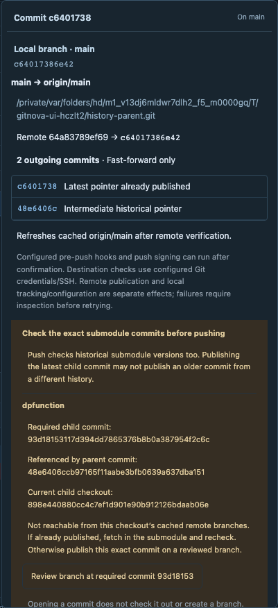
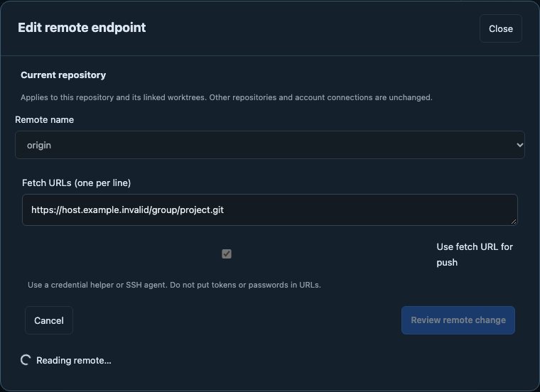

# Actionable Git errors — 2026-11-17

Version 1.0.19. Existing Fetch/Pull/Push errors now offer a contextual Review remote URL action that opens the existing scoped endpoint dialog. Changes remain reviewed, and saving never follows a redirect, forwards credentials to a redirect location or automatically retries the failed operation.

Push preview now includes bounded, offline historical gitlink evidence. It identifies each required child SHA, its parent commit, path and current checkout; it labels missing cached remote evidence honestly rather than asserting live non-publication. Known inspected missing evidence disables UI confirmation until rechecked. Incomplete/unknown inspection stays explicit and retains native Git's final guard. The native failure summary now refers to exact historical commits and fetching cached refs, rather than always recommending the current child HEAD. Legacy receipt messages remain recognized.

Review branch at required commit navigates to the existing child inspector and branch review at the exact required OID. Dangling/orphan commit objects are supported without fabricating a normal graph row or changing HEAD. Branch creation/opening and subsequent publication retain separate explicit confirmations. No recursive push or automatic branch movement was added.

## Verification

- Frontend production build and TypeScript check passed.
- Frontend unit suite: 24 files / 94 tests passed, including en/th catalog and placeholder contracts.
- `push_submodule_diagnostics`: historical orphan commit is reported even when the latest child commit is published; report clears after child publication plus Fetch, and missing cached refs reintroduce the explicit evidence warning. Missing checkouts remain incomplete and are never initialized implicitly.
- Seven selected Playwright cases passed, using real Rust core and disposable Git repositories: exact historical orphan branch review without writes; detached child branch creation/publication followed by parent publication; redirect-to-endpoint dialog with no automatic retry; both existing endpoint-dialog cases; both diff-to-editor modes. Redirect failure is injected at the UI transport boundary; endpoint writes still use the real core.
- Transport credential/helper tests: four passed; transport error classification tests: two passed, including the revised historical-commit/Fetch guidance and redirect/auth separation.
- `ref_and_push` suite: 21 passed, one failed. The failing assertion is the pre-existing in-progress stale-tracking case in `pushing_a_parent_never_implicitly_publishes_an_unpushed_submodule_commit`: it deletes the child's cached remote ref after publication and expects the next parent push to succeed. Native `--recurse-submodules=check` still refuses that state. Those existing deletion/comment edits and the final success assertion were preserved; only the expected diagnostic prefix was updated for this change. No baseline run without this feature was performed. This delivery exposes Fetch/recheck recovery and does not bypass native validation or silently fetch a child to satisfy that assertion.
- Resource limits retained: one runner at a time, at most two Rust test threads and one Playwright worker. Test writes were restricted to disposable repositories. Existing unrelated remotes.rs edits remain, including its unused include_tags build warning.

## Bounds and limits

History evidence is limited to 500 outgoing commits, 64 unique path/OID pairs and 8 MiB raw output. Local cached reachability is not a live server certificate. Historical/unregistered, unavailable or nested checkout relationships can remain unknown. Native Git's final submodule check is unchanged. Browser test transport does not certify native WebView or other-platform GUI acceptance.

`npm run build:desktop` completed with the release profile. Installed 1.0.19 over Desktop/GitNova.app 1.0.18 after confirming the app was closed. Source/installed plist versions match; built/installed executable SHA-256 values match; strict deep ad-hoc signature, all five attribution resources and installed `--verify-bundle` passed. No native GUI or workspace was opened. See [installed bundle evidence](actionable-git-errors-installed.json).
