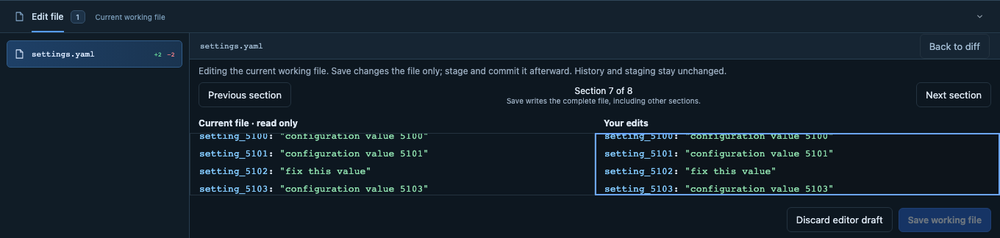

# Diff-to-editor navigation — 2026-11-17

Source version: 1.0.17. The existing Edit file action now carries the actual visible patch location into the current working-file editor. Visible changes take priority over context; deletions map to a surviving new-side neighbor. Working-file text/context matching handles line drift, with a clamped line-number fallback when matching fails. Opening selects the corresponding bounded section, focuses the draft caret and scrolls the baseline and syntax mirror to the target without rewriting file content or native Git DTOs.

## Verification

- `npm run build`: passed (TypeScript and production frontend build).
- `npm test -- --maxWorkers=1`: 24 files, 94 tests passed.
- `npm run test:e2e -- --grep 'edit file reveals|edit file opens and saves|working editor colors|edit file from historical' --workers=1`: 5 tests passed.
- New browser fixtures cover Unified and Side by side, two distant hunks, line 5102 in a multi-section file, 150 locally inserted lines, focused caret visibility, syntax mirror alignment, typing without a caret reset, and retained drafts. Files, HEAD and index remain unchanged after navigation/discard.
- Unit coverage includes repeated text, edited targets resolved by surrounding context, CRLF, removed lines, EOF/empty files, section boundaries and unmatched-line fallback.
- Existing browser regression cases cover large UTF-8 saves, stale file revalidation, drafts, syntax coloring, staging and history preservation. All Git writes ran in disposable repositories.
- `git diff --check`: passed. React review retained lazy loading, bounded sections, cancellation, native textarea behavior and no added UI strings/surfaces.
- Regenerated the macOS attribution inventory using pinned Python 3.15.2. No dependency upgrades or license audit completion claim.

Browser tests use the real Rust core through the test transport; this is not native WebView acceptance. Context matching is heuristic, not a full historical-to-working revision mapping. After the user closed GitNova, `npm run build:desktop` passed with the release profile. Installed 1.0.17 over Desktop/GitNova.app 1.0.16 and verified the installed plist version against source, byte-identical executable SHA-256, strict deep ad-hoc signature, all five license resources and `--verify-bundle` embedded UI validation. See [installed bundle evidence](installed-bundle.json). No GUI or workspace was opened for these checks. The build retained an existing unused `include_tags` parameter warning in the pre-existing remotes.rs edits; no compile errors occurred. No running app was terminated or overwritten. Existing edits to crates/gitnova-git/src/remotes.rs and crates/gitnova-core/tests/ref_and_push.rs were preserved.
