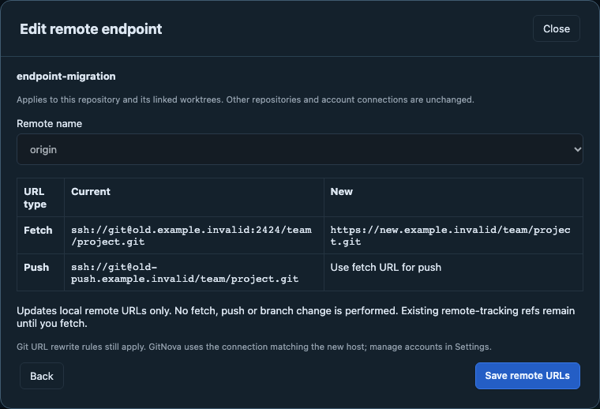

# Repository endpoint migration — 2026-11-17

Source version: 1.0.18. Clicking the existing footer remote opens a scoped dialog to edit the selected existing remote's fetch and push URLs. Current branch remote is preferred, then origin/first remote. Review shows old and new values before an explicit Save; using fetch URLs for push removes separate pushurl entries. Multiple URL order is retained, bounded to eight entries per list. No Settings tab, sidebar or commit-detail preferences were added.

The Rust adapter prepares a temporary config, revalidates the original config/effective configuration token under the common operation guard and native config.lock, retains a private original config backup and atomically publishes the reviewed config. Only selected remote URL keys change. Files, index, refs, branch/upstream configuration, refspecs and other remotes remain intact. No fetch/push is performed by this action. Cached remote refs remain until a later Fetch; scheduled auto-fetch pauses in the dialog and follows the normal post-write interval afterward. Provider and commit-identity UI reads are invalidated following a recorded operation.

## Verification

- `cargo test -p gitnova-core --test remote_endpoint --locked -- --test-threads=2`: seven passed. Covers migration with a separate old push endpoint, original config recovery through recorded activity, unchanged dirty/staged files and refs, unchanged other remotes/refspecs/upstream, multiple ordered URLs, external edits invalidating form and confirmation, retained native config.lock, unsafe/new and credential-bearing existing URLs, included config refusal and shared linked-worktree configuration.
- `cargo test -p gitnova-core --test initial_publication --locked -- --test-threads=2`: ten passed, including existing add-remote and display/credential-sanitization regressions.
- `npm test -- --maxWorkers=1`: 24 files / 94 tests passed, including English/Thai catalog contracts.
- `npm run build`: passed (TypeScript and production frontend build).
- `npm run test:e2e -- --grep 'footer remote dialog|remote endpoint dialog|edit file reveals' --workers=1`: four passed. Browser fixtures use the real Rust core in disposable repositories. Covers footer entry/focus restoration, separate old push URL, old/new review with no mutation until Save, switching locale while preserving fields, changing selected remote, cancel/Escape without changes, stale confirmation/reload and both prior diff-to-editor modes.
- React review retained lazy dialog loading, bounded inputs, request cancellation, native dialog focus containment, scoped write guards and catalog-based UI text.
- Updated the pinned native-target attribution inventory. No dependency upgrades or completed license audit claim.

## Limits

URL configuration inherited from included/global/worktree files requires Git rather than silent overrides. URL rewrite rules remain active. Provider credentials/accounts are managed separately in Settings and are not migrated. A configuration save does not establish remote access or update cached remote refs. Browser transport tests do not certify native WebView or other-platform GUI behavior. Existing unrelated edits in remotes.rs and ref_and_push.rs were preserved; the build retains the pre-existing unused include_tags warning.

`npm run build:desktop`: release build passed. Installed 1.0.18 over Desktop/GitNova.app 1.0.17 after confirming the app was closed. Source/installed plist versions match, built and installed executable SHA-256 values match, strict deep ad-hoc signature and all five license resources passed, and installed `--verify-bundle` verified the embedded UI without opening a workspace. See [installed bundle evidence](remote-endpoint-installed.json).
