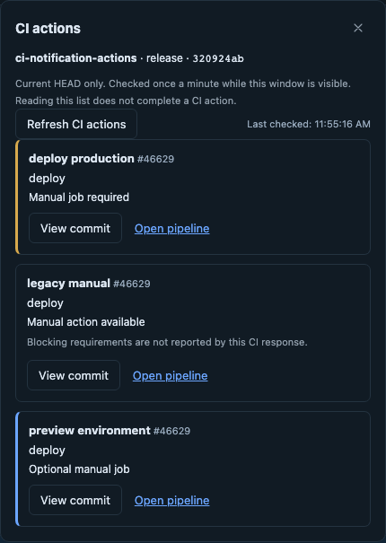

# Current-HEAD CI actions — 1.0.21

Date: 2026-11-18 (Asia/Bangkok). Branch: `feat/ci-action-notifications`,
base `a8ae64e` (main after PR #62).

## Delivered behavior

The header bell exposes outstanding manual/blocked GitLab actions for the active
repository's current HEAD and branch. It stays mounted when the user scrolls the
graph or selects older commits. The latest matching numeric pipeline ID replaces
older runs; current-HEAD changes, repository/branch changes and connection/remote
configuration invalidate the list and old in-flight results.

Each job identifies the pipeline, name/stage, required/optional/unknown evidence,
and a validated exact-project pipeline link. `allow_failure: false` is required,
`true` is optional, and missing/null evidence remains unknown. Pipeline-level
blocked/manual status can supply a fallback without fabricating a job. Optional
manual jobs in otherwise successful pipelines remain optional. See the primary
[GitLab manual-job semantics](https://docs.gitlab.com/ci/jobs/job_control/#types-of-manual-jobs)
and [Jobs API](https://docs.gitlab.com/api/jobs/).

The count is outstanding work, not unread history: opening the list does not
resolve it. Fresh observed job status removes completed/running jobs; incomplete
job pages retain unseen same-pipeline rows with explicit cached status. Failed
reads preserve qualified prior evidence and show an unavailable warning. Partial
results do not display an unqualified empty/success state.

Open commit uses existing read-only graph/inspector navigation; Open pipeline
uses `CiRunLink` and the existing native browser validation. There is no play,
approve, retry, deployment write, OS notification permission or automatic provider
mutation. English/Thai changes preserve the list. Escape (including from provider
links), outside click/focus and the close control dismiss the popover; explicit
close/Escape restores focus to the bell. The popover fits a 1024-pixel viewport.

## Resource and scope boundaries

- GitLab only; current HEAD/branch only. No workspace watcher, all-history scan,
  notification log or persisted provider payload.
- Reuse the existing serialized `readCi`/`pipelines` reader and native cache;
  provider calls remain bounded to the existing five-run/fifty-job snapshots.
  The graph's lightweight summary reader is preserved.
- Automatic attempts are throttled to sixty seconds and stop while hidden,
  blocked or unmounted. Explicit refresh is throttled to two seconds and remains
  serialized. Rapid visibility or application-state changes cannot create an
  unbounded polling loop. The existing provider HTTP/cache budgets still apply.
- Retain one active notification snapshot; fifty observed jobs plus bounded cached
  evidence and a pipeline fallback are limited to 52 entries total. No stream of duplicate notifications is appended on refresh.
- SHA, host, project, pipeline URL and scope are validated before displaying
  actionable links. Missing coverage and unavailable evidence remain explicit.

## Verification

- TypeScript check and production frontend build passed.
- Frontend unit suite: **103 tests / 25 files passed**, including seven new CI
  classification tests: required/optional/unknown, numeric latest-ref selection,
  stable deduplication, partial retention and observed resolution, pipeline-level
  fallback, successful pipelines with optional jobs, and hostile/wrong-scope data.
- Hosting suite: **41 passed / one intentionally ignored** unlocked isolated OS
  credential-store roundtrip. Provider mock HTTP verifies `allow_failure` false,
  true and missing values without posting a job action. Existing host/SHA/redirect,
  GitHub and bounded pipeline/job tests pass.
- Core integration: `ci_connections` and `pipelines`, **two passed**, using real
  temporary Git repositories and preserving their Git state.
- Browser real-core flows: **four passed** for the new feature, plus **two passed**
  for existing global graph CI and MR direction/scope behavior. CI/provider HTTP
  responses are simulated at the transport boundary; repository identity, fetch
  host matching and commit navigation still use the real Rust core. The new cases
  cover scope/config changes, hidden-window polling, locale, keyboard focus,
  refresh deduplication, stale/partial/error transitions and late read isolation.
- `cargo fmt --all -- --check` and
  `cargo clippy --workspace --all-targets --locked -- -D warnings` passed.
- An initial development run was invalidated by editing a hook during Vite HMR;
  later fresh-source runs exposed an Escape propagation issue from `CiRunLink`.
  The popover now handles Escape in capture phase and the four-case rerun passes.
  The HEAD-change test now waits for the actual new graph row before inspecting
  its new notification scope.

## Native verification limits

Desktop Rust tests passed **11/11** and desktop all-target Clippy passed after
adding the native fixture. The CI-only native runner uses typed synthetic provider
data through the real native command queue/IPC, restricted to the explicitly
enabled acceptance mode and validated private disposable catalog. It never reads
credentials or contacts the fixture host. Default native workflows retain the
previous Push/endpoint/editor flow; the CI flow is selected with `--ci-only true`.

The [first full attempt](native-full-workflow-attempt.json) reached the three
existing workflow checkpoints but did not certify the new CI flow. The
[earlier CI harness attempt](native-ci-harness-attempt.json) exposed that Tauri's
native `invoke` property cannot be replaced by browser-style assignment. The
runner now uses the isolated Rust fixture instead. The
[latest CI-only attempt](native-ci-workflow.json) stopped before CI checks because
the WebView remained hidden. **Native CI workflow acceptance is not passed.**
No task-owned native process remained after cleanup; no repeated hidden launches
or session/display changes were used to manufacture a pass. Run this focused
acceptance again only in a session where the WebView can remain visible.

Real company CI credentials/provider networking, OS notifications, cross-platform
GUI acceptance and the earlier uninterrupted foreground soak remain separate
validation scopes. This task does not claim those earlier open items are complete.

## Local package

The final release build passed and `Desktop/GitNova.app` was updated from 1.0.20
to **1.0.21**. [Installed bundle evidence](installed-bundle.json) confirms source,
built and installed versions; matching executable SHA-256; strict deep ad-hoc
signature; embedded UI; and all five attribution resources. The existing license
inventory remains `auditComplete: false` with 67 unresolved entries; no dependency
or audit-status change is claimed. The previous app was retained in a temporary
backup.

[Installed native smoke](installed-native-smoke.json) passed startup, catalog IPC,
real temporary Git graph IPC, duplicate-launch window reuse, and unchanged fixture
HEAD/worktree. This smoke does not require a visible window and does not certify
the CI popover. The local zip is
`target/alpha-evidence/GitNova-1.0.21-macos-arm64.zip` (ignored build output).
No owner catalog, credentials or real repository was opened during acceptance.

[Structured checks and source hashes](checks.json) bind the changed source files
to this verification checkpoint. No public release or source push was performed.
