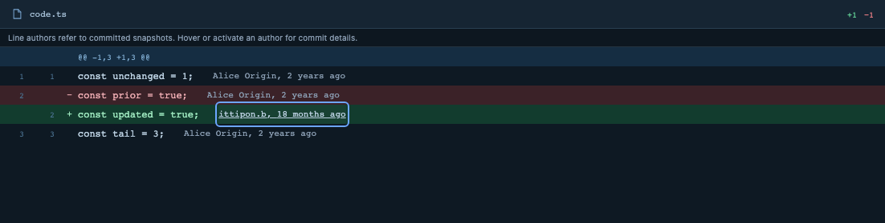
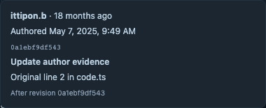

# Per-line authors in committed diffs — 1.3.0

Date: 2026-11-18 (Asia/Bangkok). Branch: `feat/diff-line-authors`,
base `1b7ff43` (workspace rename 1.2.0).

Enable **Line authors** beside the diff layout controls. Available annotations
show the original author name and relative authored time, including month-based
ages below two years. Hover, click or keyboard-activate an annotation for author,
exact date, subject, commit ID, original filename/line and inspected revision.
Escape closes details and returns focus; scrolling or selection changes close old
details. The tooltip measures its own height and remains adjacent to the anchor.
English and Thai use cached Intl formatters, not stored formatted ages.

Before reads the first parent of the selected commit; After reads the selected
commit. Unified removals use Before, context/additions use After. Root/deleted
files read only the side with content. Working/stash/merge previews retain their
existing behavior; no committed author is fabricated for mutable text.
Git's [blame semantics](https://git-scm.com/docs/git-blame) determine the last
committed attribution; native rename heuristics apply without copied/moved-line
flags. The tooltip shows the author timestamp, not a filesystem modification date.

## Bounds and evidence

The feature reuses native `investigate_history` / blame, with unchanged regular
UTF-8 file limits (1 MiB), range limits (200 lines, maximum line 1,000,000), ignore
revision-file guard and read-only repository/config checks. Only blame now also
accepts validated full SHA-1/SHA-256 object IDs. Its existing safe commit resolution
still checks the object is a commit; arbitrary revision expressions stay rejected.
Other investigation modes keep their previous explicit local-ref policy.

Reads start only when enabled and visible, after 250 ms debounce. Requested ranges
cover visible/overscan code rows; at most four pages per batch and eight pages in
the active patch hook are retained. A shared SelectionReads lane admits one active
and one replaceable pending batch. Aborting drops pending work and suppresses
stale results; an already running native read can finish. Each subsequent request
checks abort before starting. There is no polling or persistent blame payload.

Cache keys include workspace, membership, full revisions, exact native path and
side. Evidence must match membership/revision; line content must match the diff
before displaying an author. Filenames must round-trip from native bytes. Missing
commit metadata is not guessed. Partial/shallow/error/budget evidence stays
visible, with explicit Retry for failed reads. The view preference starts off and
is kept with the existing diff layout preference.

## Verification

- TypeScript passed; frontend unit suite **109 tests / 26 files passed**, including
  six new tests for side/revision range plans, bounds, identity/path validation,
  missing evidence and CRLF content checks, partial evidence, and relative English /
  Thai / future author times.
- Core investigation suite **10 passed**, including a new full-commit-ID snapshot
  case and expression rejection. Existing rename attribution, dirty-file exclusion,
  shallow limits, binary/size guards and state-preservation cases passed.
- Core + desktop all-target Clippy with warnings denied passed.
- Browser flows **3 new passed**: actual different authors before/after in split
  and unified layouts; relative/exact dates and tooltip keyboard/geometry; Thai;
  root scope; real configured ignore-file refusal and explicit retry; a held old
  request followed by selection change, discarding its result and canceling the
  remaining obsolete batch. Actual catalog/Git reads use the Rust core via an
  emulated Tauri boundary and disposable fixtures.
- Existing browser history/diff/workspace and historical-file editor regressions
  **2 passed**. HEAD/worktree preservation was checked on the new fixtures.
- Final targeted three-case rerun after measured tooltip placement passed. Earlier
  attempts exposed that the old blame reader interpreted object IDs as branch
  names; the strictly bounded full-ID path fixed that. Escape also needed hover
  suppression and non-overlapping positioning to avoid reopening the tooltip.
- Formatter and version synchronizer checks are recorded in `checks.json`.

## Local delivery

The user confirmed closing GitNova; fresh process checks before building and
replacement found it closed. Release build **passed**, including the TypeScript
check and production frontend assets. Source hashes still match the verified
feature checkpoint `af51c80`; completed feature suites were not repeated.

Installed **1.3.0** at `Desktop/GitNova.app`, replacing 1.2.0 and retaining the old
app in a temporary backup. [Bundle evidence](installed-bundle.json) confirms
source/built/installed versions, matching executable SHA-256, strict deep ad-hoc
signature, embedded UI and all five attribution resources. Existing inventory
status is unchanged: audit incomplete, 67 unresolved entries. No dependency
upgrade or trusted-signing/notarization claim is made.

[Installed native smoke](installed-native-smoke.json) passed startup, native catalog
and real temporary Git graph IPC, duplicate-launch window reuse, and unchanged
fixture HEAD/worktree. It validates startup/IPC, not physical native GUI acceptance
of each author annotation. The local archive is
`target/alpha-evidence/GitNova-1.3.0-macos-arm64.zip` (ignored build output).

Earlier native CI / uninterrupted foreground soak and the existing license audit
remain separate open scopes. No push/public release, owner catalog, company
credentials or real repository was used by these acceptance checks.
