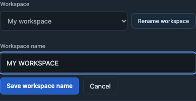

# Workspace rename — 1.2.0

Date: 2026-11-18 (Asia/Bangkok). Branch: `feat/workspace-rename`, base `d475a4d`.

The workspace picker now includes Rename workspace beside its dropdown. Save
changes the existing workspace's local catalog label, including `code` → `Code`,
without replacing the workspace, memberships, selected repository or Git paths.
The atomic catalog store publishes a new name only after persistence succeeds.
Names are trimmed, case is preserved, and the accepted range is 1–80 Unicode
scalar values. Existing create-workspace validation and duplicate-name policy
are unchanged; workspace identity is its ID.

Enter saves, Escape/Cancel cancels editing and restores focus to Rename workspace.
Success returns focus and announces the updated name. Errors retain the draft and
prior label for retry. One in-memory workspace-scoped draft survives closing the
picker to change language in Settings; it is cleared by successful Save or Cancel.
All product labels and validation are available in English/Thai. No separate screen
or dialog was added; rationale is in the surface budget.

## Verification

- TypeScript check passed; frontend unit suite: **103/25 files passed**.
- Core rename integrations: **3 passed**, covering case-only rename and reopened
  persistence, retained catalog identities/memberships/selection, inactive workspace
  scope, Unicode boundary validation, unknown identity and failed disk persistence
  without changed in-memory catalog or original stored name.
- Desktop all-target Clippy with warnings denied passed; formatter checked before
  packaging. Version synchronizer tests passed **1/1**; final release build passed
  including TypeScript and production frontend assets.
- Browser with real Rust core/Git fixtures: **2 rename cases + 1 existing workspace,
  history and diff regression passed**. Covers validation, Escape, focus, reload,
  locale change through Settings while retaining the typed draft, failed write
  with unchanged label and explicit retry. Browser transport emulates Tauri IPC;
  catalog reads/writes and Git graph results use the actual core.
- Early browser attempts exposed a duplicate React sibling key and fixture waits /
  status selectors that were too broad. Keys now include the component scope;
  tests wait for the loaded graph and inspect rename's own status. The final
  fresh-source three-case run passed without those failures.

## Local delivery

Installed **1.2.0** at `Desktop/GitNova.app`, replacing 1.1.0 with a temporary
backup of the old app. [Bundle evidence](installed-bundle.json) confirms source,
built and installed versions, matching executable hashes, strict deep ad-hoc
signature, embedded UI and all five attribution resources. Existing audit status
remains incomplete with 67 unresolved entries; no dependency upgrade was made.

[Installed native smoke](installed-native-smoke.json) passed startup, catalog / real
Git graph IPC, duplicate-window reuse and unchanged temporary fixture HEAD/tree.
[Structured checks and source hashes](checks.json) record this checkpoint.
Local zip: `target/alpha-evidence/GitNova-1.2.0-macos-arm64.zip` (ignored output).
 Native startup is separate
from physical GUI acceptance of the rename form. Prior visible native CI and
foreground-soak limits are unchanged. No real company provider, owner catalog or
real repository is used by acceptance fixtures; no public push or release.
